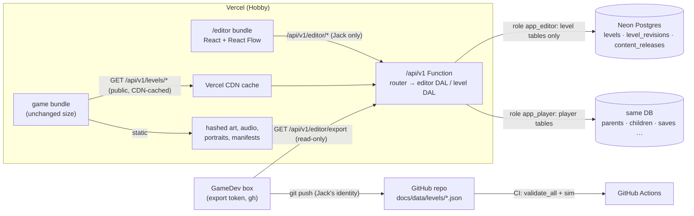
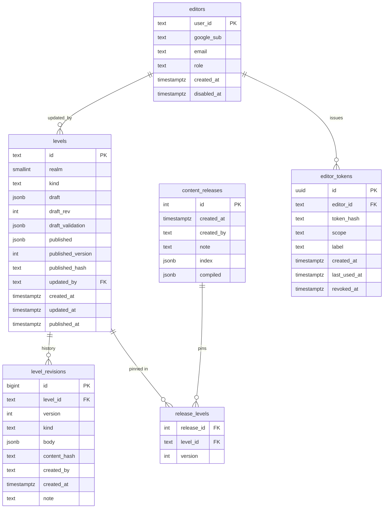
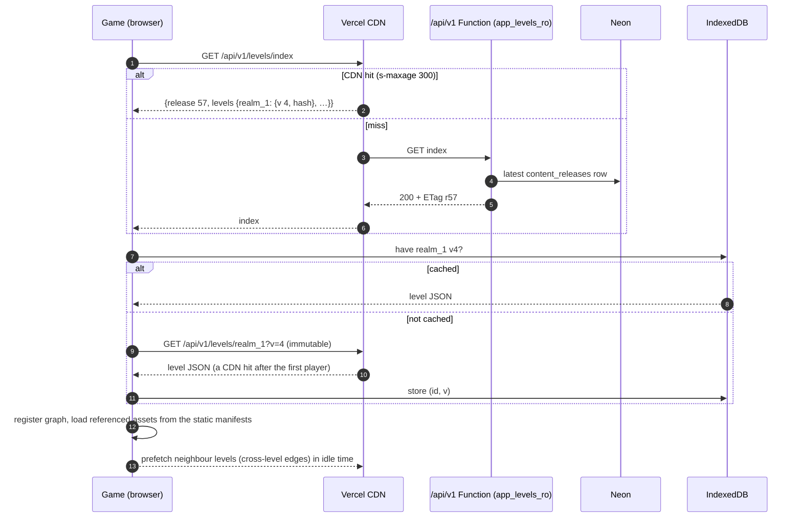
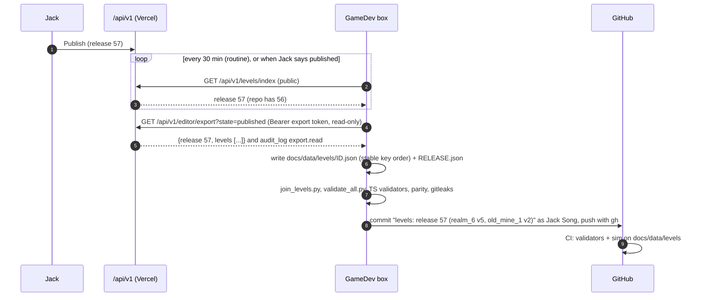

# Level and script editor: design doc

**Status: 📝 PROPOSED, waiting for Jack's approval. Nothing here is built.** Written 2026-10-10 (PT) by GameDev against main `e4e6a4a`.
**Owner:** GameDev. **Content owner:** Desy. Her companion doc [design/level-json-coverage.md](../design/level-json-coverage.md) is the must-cover checklist for the schema; this doc follows her names (`level/0.1`, `levels.draft`, `draft_rev`, `published_version`, `level_revisions`, `/api/v1/editor/*`, `server/seed-levels.mjs`, `tools/level/split_levels.py` / `join_levels.py`).
**Jack's decisions applied (2026-10-10):** a level is its own zone (no zone layer, §2.4); the DB is the live source of level content, the editor and backend have no GitHub write access, and GameDev exports published levels into the repo from its box (§9).

## Contents

0. [What Jack saw on Vercel (factual answer)](#0-what-jack-saw-on-vercel-factual-answer)
1. [Goals, non-goals and the recommendation](#1-goals-non-goals-and-the-recommendation)
2. [The level JSON schema (`level/0.1`)](#2-the-level-json-schema-level01)
3. [DB tables](#3-db-tables)
4. [Editor auth](#4-editor-auth)
5. [Editor UI and library](#5-editor-ui-and-library)
6. [Save, validate, publish, rollback](#6-save-validate-publish-rollback)
7. [Runtime load path](#7-runtime-load-path)
8. [Migrating Desy's v3.9.x data](#8-migrating-desys-v39x-data)
9. [Source of truth: DB live, repo export by GameDev](#9-source-of-truth-db-live-repo-export-by-gamedev)
10. [Rollout, risks, security and privacy](#10-rollout-risks-security-and-privacy)
11. [Open questions for Jack (with defaults)](#11-open-questions-for-jack-with-defaults)
12. [Schema questions for Desy](#12-schema-questions-for-desy)

---

## 0. What Jack saw on Vercel (factual answer)

**Short version: nothing is broken. The graph world sits behind a flag, and on Vercel a guest gets the classic world by default.** Checked in the code and in headless Chrome against `https://chinese-rpg.vercel.app` on 2026-10-10 at about 09:30 PT. The probe signed in to nothing and created no accounts.

**The code.** `src/world/mode.ts` reads the mode once at load:
1. In the accounts build only (`__CLOUD__`, which Vercel sets): if `localStorage["chinese-rpg-cloud"]` holds a `childId`, the mode is **graph**, with no exceptions.
2. Otherwise `?world=graph|classic` wins, and **the choice is remembered** in `localStorage["chinese-rpg-world-mode"]`.
3. Otherwise it uses the stored choice, and the default is **classic**.

`src/main.ts` then calls `startGraph()` or `town()` after `accountBoot()` (`src/ui/account.ts`), and `pickChild()` writes the child marker and reloads, so rule 1 applies to every child profile.

| Path | What Jack sees (observed) | Graph, scene, NPCs, quests? |
|---|---|---|
| **Guest, plain URL** (what Jack did) | Title screen (`Play as guest` / `Parent sign-in`) → "Grown-ups first!" consent → the **classic town**: Inn, Equip, Shop, Words, Gate, Magic, Quests board, Adventure. `GET /api/v1/me` → 401 as expected. Mode not set. | **No.** This is the classic prototype, by design. |
| **Guest, `/?world=graph`** | Title → consent → "What's your name?" → the **realm 1 node graph** (`data-graph` realm_1; landmarks village, m_fork, m_crow, c_den, w_throne are visible, the rest is fog; exit button and "Go in") with the **opening scene `sc_r1_opening`** playing over it (portraits, "Little Hill Village. Today is Probe's birthday.", the egg hatches, Xiaolong says **你好!** with the gloss "hello!", a choice), then the tutorial rabbit battle. `world/graphs/realm_1.json` on Vercel is **byte-identical** to the repo and holds NPC node `m_farm` (Farmer Li) with quest offers `m_farm.1`, `m_farm.2` and `w_path.1`. The choice sticks: later visits without the parameter stay in graph mode until `?world=classic`. | **Yes**, the same as the GitHub build. The probe saw the graph and the opening scene. It did not walk to `m_farm` (it's under fog at the start), but the data and code are identical to Pages. |
| **Signed-in child** | Forced into graph mode. Simulated without signing in by setting only the local child marker: the game went straight to the name prompt, then the graph and the opening scene, with the "signed out" banner because there was no session. A real child gets the same thing without the banner. | **Yes**, always. |

**Real gaps (none of them a bug):**
- A guest on Vercel can reach the graph world **only** through the URL parameter. No button offers it.
- A parent trying the game as a guest sees classic, while their children see graph.
- The fog hides `m_farm` at the start, so in the first minute "NPC interactions" means only the opening scene.

Jack's plan covers all three: graph becomes the Vercel default **after** the editor exists (§10, phase 7).

## 1. Goals, non-goals and the recommendation

**Goals**
- **One editor at `/editor` on Vercel.** Only Jack can sign in. With it Jack can:
  - draw and edit graphs (nodes, links, mazes, Desy's existing 36 levels);
  - choose what each node is (village or town, portal, treasure, NPC, quest battle, item, story, nothing…);
  - write dialogue (speaker, portrait expression, Chinese plus English gloss, no pinyin);
  - pick each level's word pool, enemies, boss, backdrop, music and encounter odds;
  - Save, then Publish.
- **One JSON object per level** holds everything the level needs: the graph, events, node quest-state variants, the quests given there, and dialogue scenes. It refers to assets by id only.
- **The game loads published levels from the API**, caches them, and keeps working offline.
- **Live saves keep working** through edits: ids are stable and are never reused.
- **Still $0** on Vercel Hobby and Neon Free.

**Non-goals**
- Editing balance: enemy stats, boss HP, prices and the 3-new-words cap stay global tables in the repo. Desy's rule; encounter odds are the one per-level exception Jack asked for (§2.4).
- Editing curriculum contents. Levels **pick** pool ids and item ids.
- Uploading art or audio from the editor. Assets stay static and versioned with the build (D5). The editor picks from the asset manifest.
- Multi-user editing, comments, or branching drafts. There is one editor (Jack).
- Any change to the battle engine, or new quest mechanics. Variants compile to today's events (Desy §2).

### 1.1 Recommendation in 10 lines

1. **Schema `level/0.1`:** one level = one graph = its own zone (36 levels; 38 if Jack approves Desy's realm_1 split). It holds one `settings` block (pool, roster, boss, backdrop, music, odds, unlocks), nodes, edges, events, node `quests[]` variants, quests given here, and scene/0.2 dialogue.
2. **Ids are append-only:** never reused and never renamed after publish (the game doesn't apply `renames`).
3. **DB:** `levels` (draft + published JSON, `draft_rev`, `published_version`), append-only `level_revisions`, `content_releases`, `editors`, `editor_tokens`. Under 100 MB for years.
4. **Auth:** the existing Auth.js Google sign-in, plus an `editors` allowlist checked in a separate editor DAL, kept apart from parent and child data by a separate Postgres role.
5. **UI:** React + React Flow (`@xyflow/react`) in a **separate Vite entry** (`editor.html`). The game bundle grows by 0 bytes.
6. **Validators** ported to TypeScript (ajv + zod) run in the browser and in the Function. A CI parity test against Desy's Python validators keeps them aligned.
7. **Flow:** autosave a draft (never blocked), then Publish (blocked by errors) in one transaction that bumps the version and writes a revision and a `content_release`. Rollback = republish an old revision.
8. **Runtime:** `GET /api/v1/levels/index` (short CDN cache) plus `GET /api/v1/levels/:id?v=N` (immutable, CDN-cached), an IndexedDB cache, neighbour preload, and the bundled last export as the offline fallback.
9. **Source of truth:** the DB is live. GameDev's box pulls the read-only export and commits `docs/data/levels/` with gh, so git keeps the history and the backup, and CI and the sim read it. The DB wins; repo changes return only through a deliberate import.
10. **Rollout in 7 phases, about 6–8 weeks of agent work.** Graph becomes the Vercel default only after the editor ships. The zone code is removed in phase 6.



---

## 2. The level JSON schema (`level/0.1`)

The version is `level/0.1` (Desy's name). It becomes `level/1.0` when the editor ships to Jack. The JSON Schema lives in the repo at `docs/data/levels/schemas/level.schema.json`, next to the shared `common.schema.json` (conditions and actions), `scene.schema.json` and `quests.schema.json`.

### 2.1 Top level

| Field | Type | Notes |
|---|---|---|
| `schema` | `"level/0.1"` | |
| `id` | `^[a-z0-9_]+$` | Equals today's graph id (`realm_1`, `old_mine_1`, `world`). **Permanent.** |
| `version` | int | Set by the server on publish (`published_version`). Read-only in the editor. |
| `kind` | `world` · `overworld` · `dungeon_level` · `town` | `town` is new and optional, for a walk-in town map later. Today towns are nodes. |
| `realm` | 0–9 | 0 for `world` |
| `dungeon`, `level`, `levels`, `optional` | as graph/0.3 | A multi-floor dungeon = several levels sharing `dungeon`. The editor groups them. |
| `title` | `{zh, zhTrad?, en}` | |
| `status` | `reference` · `authored` | Desy Q7: a level Jack edits becomes `authored` |
| `entry` | node id | The arrival node |
| `aspect` | number | Width/height. Node x/y are normalised 0–1 against it. |
| `idxMax`, `edgeIdxMax` | int | Only grow (§2.9) |
| `retired` | `{nodes[], edges[], events[], quests[], scenes[]}` | Deleted ids, never handed out again |
| `settings` | object | **The per-level settings that replace zones**, including the optional `boss` record (§2.4) |
| `realms` | array | Only in `world`: realm links, as today's `world.json` |
| `nodes`, `edges`, `events` | arrays | §2.2–2.3. `events` keeps list order, because order is data (first eligible wins). |
| `quests` | array | Quest definitions **given in this level** (§2.6) |
| `scenes` | object `{id: scene/0.2}` | Every scene that triggers in this level, inline graph dialogue included (§2.5) |
| `characters` | string[] | Character ids used here (refs into the global registry); computed on save |
| `assets` | object | `{backgrounds[], music[], portraits[], sprites[]}` ids; **computed on save** from the content, used for preload (§7) |

### 2.2 Nodes

As graph/0.3, with the same field names (Desy's rule):
- `id`, `idx`, `kind`, `x`, `y` (0–1, the editor keeps 0.05–0.95), `title`;
- `save`, `services`, `hub`, `town`, `shops`, `campfire`, `npc`, `fog`, `inBuild`.

The `zone` field is **removed** (§2.4). One field is **added**: `quests[]`, the quest-state variants (§2.6).

Jack's "what happens here" maps to `kind` plus the node's first event. The editor offers the friendly menu on the left and writes the data on the right:

| Jack picks | Writes |
|---|---|
| Village / Town | `kind: village` / `kind: town` + `town: N`, `services` |
| Inn / campfire | `kind: inn` (+ `campfire: true`) |
| Portal to another map / dungeon | `kind: portal` (or `stairs_up` / `stairs_down`) plus a **cross-level edge pair** (§2.3). The target dropdown lists published and draft levels and their nodes. |
| Treasure | `kind: chest` + event `{on: enter, once: true, outcome: treasure, do: [{openChest: chest_normal}]}` |
| NPC encounter | `kind: npc`, `npc: <character id>`, + event `{on: talk, do: [{scene: …}]}` |
| Quest battle | `kind: miniboss` + a quest step variant whose `in` is `{do: [{fight: {...}, quest}], outcome: miniboss}` (pick the quest and step) |
| Item | event `{outcome: item, do: [{giveItem: …}]}` |
| Story event | `kind: story` + event `{outcome: story, do: [{scene: …}]}` |
| Location boss | `kind: boss`; the level's `settings.boss.node` points here |
| Nothing / path | `kind: waypoint` or `fork`, with no event |
| Lever, shop, exit | as graph/0.3 |

### 2.3 Edges and encounters

As graph/0.3:
- `id`, `idx`, `from`, `to`, `kind` (path, stairs, portal, exit, shortcut);
- `danger` 0–3, `steps`, `terrain`, `patrol`;
- `scripted {enemies, fill, once, step}`, `cond`, `opens`, `label`.

Rules:
- **Danger is the encounter rule per edge.** Per-level odds (§2.4) turn danger into a chance per step; `patrol: true` marks the boss approach (no random battles); `scripted` places a fixed fight.
- **Cross-level edges** (stairs, portals, exits) have `to: {graph, node}` and are stored **on both levels**. The editor creates, retargets and deletes the pair together, and publish validates the pair as a set (§6.3).
- **Links** (Jack's word) are not stored separately; the editor shows them as the list of cross-level edges.

### 2.4 Per-level settings and the boss (a level is its own zone)

Jack's decision on 2026-10-10: **zones disappear from the schema and the editor.** There is no zone record, no node `zone` field and no zone layer in the UI. Everything a zone held is in **one `settings` block per level**, which is Desy's block (coverage doc §1.3) with the same field names:

```json
"settings": {
  "title": {"zh": "灰雾村", "en": "Gloomy Village"}, "emoji": "🏚️",
  "background": "bg_village_fog", "music": "village_theme",
  "desyPool": "L6.1", "pool": "gloomy_village",
  "tier": 6,
  "enemiesPerBattle": [3, 3],
  "roster": [{"enemy": "zombie", "weight": 1}],
  "packs": {}, "elite": "zombie_knight", "scriptedElite": null,
  "encounters": null,
  "unlockRequires": ["hydra_lair_2"],
  "boss": {"node": "boss_1", "gateEdge": "e10", "kind": "locboss", "enemy": "zombie_mayor"}
}
```

(These are `realm_6`'s settings, copied from today's `gloomy_village` zone. The emoji, background and music ids are illustrative.)

| Setting | Meaning | Editable? |
|---|---|---|
| `title`, `emoji`, `background`, `music` | the location name shown in battle, its backdrop and its music (the level's own map title stays at the top level) | yes |
| `desyPool` (`L1.1`…`L9.2`) + `pool` (the location pool key, e.g. `clover_hills`) | the word pool. `pool` keeps today's key for location battle state (`S.locs`) and review order, so saves don't change. | pick by id (Desy Q4) |
| `tier`; `G` and `recLevel` (derived) | from the global tables; shown, not typed | tier only |
| Difficulty row: `mcOptions`, `reviewSlots`, `pathFights`, `maxNewPerBattle` | read from `realm_location_difficulty.csv` by `desyPool` | **read-only** (decision 17) |
| `enemiesPerBattle`, `roster` (enemy + weight), `packs`, `elite`, `scriptedElite` | enemy **ids** only, never copied stats | yes (Desy Q5: stats no) |
| `encounters` | `null` = the global `world_rules` odds. An object = a per-level override (Jack's spec), e.g. `{"danger": {"1": 0.5}}`, clamped to the global max 0.95. | yes, if Jack confirms (Q8). Desy keeps rates global; see D4 in §12. |
| `unlockRequires` | the previous boss **level** id(s); the gating itself stays on edges (`cond bossDefeated`) | yes |
| `boss` (optional) | **the location or realm boss of this level**: `node`, `gateEdge` (the one `patrol` edge), `kind` (`locboss` / `realmboss`), `enemy`, and for a realm boss `reward` (today's `bossReward`) | yes; at most one per level |

**What the editor does with it:**
- The Level Settings panel (§5.3) is the only place pools and enemies are picked.
- Pool contents, the 3-new cap, Tired caps, enemy stats and boss HP stay global (Desy).
- The editor warns when a boss of another tier or type is picked.

**Bosses and unlocks are keyed on level ids** (Desy §3.9.4):
- `bossDefeated: <zone>` becomes `bossDefeated: <boss level>` through Desy's 20-row table (e.g. warren → `warren`, great_hive → `great_hive_1`, throne_hall → `demon_castle_5`). That covers:
  - 5 conditions in `realm_1`, 16 in `world.json` and 17 in `quests.json`;
  - the 21 `unlockRequires` entries.
- `realms[].realmBossZone` becomes `realmBossLevel`, and `realms[].unlock` uses the same ids.
- It is a 1:1 rename, so every gate opens at exactly the same moment as today.
- **Saves:** `zonesDefeated` holds boss level ids after a **one-time save migration** through the same table (§7.3). It is 1:1, so the "bosses beaten" count in `server/progress.ts` doesn't change.

**The battle budget** (8 battles, pity 2) resets **when the level's word pool changes** (Desy §3.9.3, her Q18). Floors of one dungeon that share a pool keep sharing one budget, as today. The budget id is the level's `pool`, the same strings as today, so it needs no migration.

**How today's zones map onto levels** (Desy §3.9.1–3.9.2, followed here rather than re-invented):
- **25 of the 36 graphs** hold exactly one zone and copy it.
- A zone that spans several graphs (14 of 20) is **copied into each of them**, so every dungeon floor keeps today's pool, roster and difficulty row.
- The **boss record** goes only to the level holding the boss node. Each of the 20 boss nodes is in exactly one graph.
- **9 graphs** hold one stray "doorway" node of the next zone (a portal or stairs-down after a location boss). **These stay in their own graph's level** (no map, id or save change). Only their 9 approach edges (17 danger-2 steps) now fight in the pool just cleared. On the beeline that is −2.0 to +0.3 battles per realm; five realm-boss locations drop to 5.1–6.3 own-pool battles before their boss (Desy Q17).
- **`realm_1`** holds three real zones (meadow, clover_hills, warren), each with its own boss.
  - **Desy proposes splitting it into three levels** (`realm_1`, `clover_hills`, `warren`, joined by portal links, with battles identical to today), which would make 38 levels.
  - **⏳ PENDING Jack's confirmation, not planned as decided.** Until then this doc counts **36 levels**, and the migration keeps `realm_1` whole, with a flag that blocks its publish until the decision (Q1b).
  - If approved, the split happens in the seed **before** the first publish, plus a one-time realm-1 save migration (node idx 7–16 and edge idx 8–18 move; Desy §3.9.2 A).
- `world` has no settings for battles.

**Code that still depends on zones:** Desy lists it in §3.9.6:
- `zones.json` and the zone schemas;
- `src/world/engine.ts` (`Zone`, `realmOpen`, `P.zone` budget, `edgeZone`);
- `src/ui/graph.ts` (`zoneOf`, boss fights, budget reset);
- `src/world/content.ts`, `src/data.ts`, `src/world/progress.ts`, `src/engine/battle.ts`;
- `server/progress.ts`, `server/dal/saves.ts`;
- the tests and the Python tools.

Phase 6 removes it (§10).

### 2.5 Dialogue scenes (scene/0.2, unchanged)

`scenes` maps scene id → a scene/0.2 object exactly as in `docs/data/dialogue/` (Desy: no new line format):
- `slots` L1/L2/R1/R2 `{char, expr}`;
- lines `{id, speaker, side, expr, en, zh?, zhTrad, tokens, if/else, goto, end, choices…}`.

Rules:
- `speaker` and `char` are **character ids** in the global registry.
- `expr` is one of the 7 portrait expressions.
- The portrait image is resolved from the character id + expression, through `public/portraits/portraits_index.json`.
- **`zhTrad` is generated on save** (OpenCC s2tw, in the Function) and stored.
- **There is no pinyin field** (decision 18).
- `scene.zone` becomes implied by the level; `trigger.graph` must equal the level id.

### 2.6 Quests and node quest-state variants

**Ownership (decided here):** a quest definition (quest/0.2: steps, rewards, `requires`, `words`, `scenes`) is **owned by the giver's level** (`quests[]`). Every other level that takes part refers to it by id. That gives one owner, rewards in one place, and a definition that is edited where Jack meets the giver.

**Variants:** a node's `quests[]` (Desy §2.2) is keyed by quest id and role:

```json
{"quest": "q6_old_mine", "role": "giver",
 "pre":  {"scene": "sc_q6_old_mine_offer"},
 "in":   {"scene": "sc_q6_old_mine_wait"},
 "post": {"scene": "sc_q6_old_mine_thanks", "after": "sc_q6_old_mine_after"}}
```

| Jack's state | Runtime state | Variant key | What plays (compiled to today's events, no engine change) |
|---|---|---|---|
| pre-quest: meet the giver | available (`requires` met, not started) | `pre` | offer scene → `offerQuest` |
| in-quest | `active` | `in` (giver) | the progress scene ("have you done it?") |
| in-quest, at step nodes | `active` | `in` (role `step`, `step: sN`) | the quest item, the quest enemies (`fight`) or a line, gated by `questActive` |
| ready to turn in | `ready` (`questReady`) | `post.scene` | the turn-in scene, then the quest's rewards, once |
| done | `completed` (`questDone`) | `post.after` | the closing line on later visits |

```mermaid
stateDiagram-v2
  [*] --> available: requires met
  available --> active: pre (offer scene), Accept
  active --> active: in (giver progress scene; step nodes give item, fight or line)
  active --> ready: last step before turn-in done
  ready --> completed: post.scene (turn-in) + rewards from the quest definition
  completed --> completed: post.after (closing line)
```



- **Rewards live only in the quest definition**, as multiples of G and L.
- `questDone` and `questClaimed` mean the same in the engine (`src/world/engine.ts`); the editor shows "done".
- `questReady` is added to `common.schema.json` (Desy §1.7).

**Cross-level quests:** at least 13 of 50 quests have steps in another graph.
- The definition sits in the giver's level.
- Steps name their place as `{graph, node}`.
- Each step node carries a `role: step` variant in **its own** level.
- The validator checks both directions across the published set: every step has a variant, and every variant points at a real quest and step.
- A quest whose steps change in two levels is published as a **set** (§6.3).
- The editor's quest view lists the giver, the steps and the turn-in, and jumps between levels.
- At publish the server compiles the runtime quest list (quest/0.2) from all levels into the release.

### 2.7 Assets by id only

The level never holds a URL or a file name. It holds only these ids:
- `background` / `music` ids (`public/` manifests);
- character ids + expressions (`public/portraits/`);
- enemy ids (sprites via `tools/sync_sprites.sh` output);
- item and gear ids.

The editor's pickers read the same static manifests the game uses. The validator rejects unknown ids. The server computes `assets` on save for preload.

### 2.8 Global data stays global (in the repo)

These stay in the repo:
- `world_rules.json` (defaults);
- the curriculum and pools;
- `enemies.csv` / combat data / `boss_hp.csv`;
- economy, items, gear, spells and towns;
- the characters registry;
- `progress.schema.json`.

They ship with the deploy, so the Function's validators and the editor's pickers use the same versions. A level that references an id the current deploy doesn't know fails validation.

### 2.9 Stable ids, retirement and no renames

- The ids of levels, nodes, edges, events (`<node>.<n>`), quests, steps and scenes are **save keys and RNG keys**. Seeds hash `saveSeed|graphId|edgeId|crossing|step` and `…|nodeId|visit`. Bitsets index by `idx`.
- New nodes and edges get `idxMax+1` / `edgeIdxMax+1`. A deleted id goes into `retired` and is never reused (the server also checks against every past revision).
- **No renames after publish.** `index.json` has a `renames` map, but **the game does not apply it** (no reference in `src/`). The policy is therefore **ids are fixed once published**:
  - before the first publish, ids are free text;
  - after it, the editor shows the id read-only and offers a free-text title instead.
  - If a rename is ever needed, implementing `renames` in `src/world/progress.ts` comes first.

### 2.10 Full example

A trimmed `old_mine_1` as it would look after migration: 6 of its 13 nodes, with a quest step, an NPC giver and one scene. It is valid against the draft schema. It has no boss of its own: it copies the `gloomy_village` zone settings (Desy §3.9.1, row 17), and its settings have no `boss` record (that boss is in `realm_6`).

```json
{
  "schema": "level/0.1",
  "id": "old_mine_1",
  "version": 1,
  "kind": "dungeon_level",
  "realm": 6,
  "dungeon": "old_mine", "level": 1, "levels": 1, "optional": true,
  "title": {"zh": "旧矿洞 第1层", "zhTrad": "舊礦洞 第1層", "en": "Old Mine (optional) - level 1"},
  "status": "reference",
  "entry": "stairs_1",
  "aspect": 3.515,
  "idxMax": 12, "edgeIdxMax": 13,
  "retired": {"nodes": [], "edges": [], "events": [], "quests": [], "scenes": []},
  "settings": {
    "title": {"zh": "灰雾村", "en": "Gloomy Village"}, "emoji": "🏚️",
    "background": "bg_mine", "music": "dungeon_theme",
    "desyPool": "L6.1", "pool": "gloomy_village",
    "tier": 6,
    "enemiesPerBattle": [3, 3],
    "roster": [{"enemy": "zombie", "weight": 1}],
    "packs": {}, "elite": "zombie_knight", "scriptedElite": null,
    "encounters": null,
    "unlockRequires": ["hydra_lair_2"]
  },
  "nodes": [
    {"id": "stairs_1", "idx": 0, "kind": "stairs_up", "x": 0.05, "y": 0.5, "title": {"zh": "楼梯", "en": "Entrance"}},
    {"id": "path_1", "idx": 1, "kind": "fork", "x": 0.23, "y": 0.5, "title": {"zh": "暗厅", "en": "Dark hall"}},
    {"id": "treasure_1", "idx": 2, "kind": "chest", "x": 0.41, "y": 0.2, "title": {"zh": "宝库", "en": "Vault"}},
    {"id": "deadend_1", "idx": 6, "kind": "miniboss", "x": 0.59, "y": 0.35, "title": {"zh": "小头目", "en": "Mini-boss lair"},
     "quests": [{"quest": "q6_old_mine", "role": "step", "step": "s3",
                 "in": {"outcome": "miniboss", "do": [{"fight": {"enemies": ["zombie", "zombie", "zombie_knight"], "kind": "miniboss"}, "quest": "q6_old_mine"}, {"setFlag": "q6_old_mine.s3"}]}}]},
    {"id": "story_2", "idx": 8, "kind": "story", "x": 0.41, "y": 0.8, "title": {"zh": "故事点", "en": "Story spot"},
     "quests": [{"quest": "q6_old_mine", "role": "step", "step": "s4",
                 "in": {"outcome": "story", "do": [{"scene": "sc_q6_old_mine_miners"}]}}]},
    {"id": "npc_1", "idx": 9, "kind": "npc", "npc": "miner_gao", "x": 0.59, "y": 0.65, "title": {"zh": "矿工", "en": "Miner Gao"},
     "quests": [{"quest": "q6_old_mine", "role": "giver",
                 "pre":  {"scene": "sc_q6_old_mine_offer"},
                 "in":   {"scene": "sc_q6_old_mine_wait"},
                 "post": {"scene": "sc_q6_old_mine_thanks", "after": null}}]}
  ],
  "edges": [
    {"id": "x_stairs_1", "idx": 0, "from": "stairs_1", "kind": "stairs", "to": {"graph": "realm_6", "node": "portal_2"}},
    {"id": "e1", "idx": 1, "from": "stairs_1", "to": "path_1", "kind": "path", "danger": 2, "steps": 1, "terrain": "tunnel"},
    {"id": "e2", "idx": 2, "from": "path_1", "to": "treasure_1", "kind": "path", "danger": 2, "steps": 2, "terrain": "tunnel"},
    {"id": "e6", "idx": 6, "from": "path_1", "to": "deadend_1", "kind": "path", "danger": 1, "steps": 1, "terrain": "tunnel"},
    {"id": "e8", "idx": 8, "from": "path_1", "to": "story_2", "kind": "path", "danger": 1, "steps": 1, "terrain": "tunnel"},
    {"id": "e9", "idx": 9, "from": "treasure_1", "to": "npc_1", "kind": "path", "danger": 1, "steps": 1, "terrain": "tunnel"}
  ],
  "events": [
    {"id": "path_1.1", "node": "path_1", "on": "enter", "pick": [
      {"weight": 70, "outcome": "nothing", "once": false, "do": []},
      {"weight": 15, "outcome": "story", "once": false, "do": [{"scene": "sc_old_mine_1_ambient"}]},
      {"weight": 15, "outcome": "item", "cooldown": 4, "do": [{"giveItem": "honey", "qty": 1}]}]},
    {"id": "treasure_1.1", "node": "treasure_1", "on": "enter", "once": true, "outcome": "treasure", "do": [{"openChest": "chest_normal"}]},
    {"id": "treasure_1.2", "node": "treasure_1", "on": "enter", "once": false, "outcome": "nothing", "do": []}
  ],
  "quests": [
    {"schema": "quest/0.2", "id": "q6_old_mine", "realm": 6, "pool": "L6.1", "story": "side", "type": "rescue",
     "title": {"zh": "老矿井", "en": "Trapped in the Old Mine"},
     "giver": {"npc": "miner_gao", "graph": "old_mine_1", "node": "npc_1"},
     "alsoOnBoard": false, "turnIn": "giver", "returnToGiver": true, "requires": null, "order": "sequence", "repeatable": false,
     "objectives": [
       {"id": "s1", "event": "reach", "objective": {"type": "reach"}, "where": {"graph": "realm_6", "node": "portal_2"}, "note": "was event: portal (dropped in v3.9.2)"},
       {"id": "s2", "event": "quest_offer", "objective": {"type": "talk", "npc": "miner_gao"}, "where": {"graph": "old_mine_1", "node": "npc_1"}},
       {"id": "s3", "event": "miniboss", "objective": {"type": "kill", "enemies": ["zombie", "zombie", "zombie_knight"]}, "where": {"graph": "old_mine_1", "node": "deadend_1"}},
       {"id": "s4", "event": "story", "objective": {"type": "reach"}, "where": {"graph": "old_mine_1", "node": "story_2"}},
       {"id": "s5", "event": "quest_offer", "objective": {"type": "talk", "npc": "miner_gao", "turnIn": true}, "where": {"graph": "old_mine_1", "node": "npc_1"}}],
     "scenes": {"offer": "sc_q6_old_mine_offer", "progress": "sc_q6_old_mine_wait", "turnIn": "sc_q6_old_mine_thanks"},
     "rewards": {"gold": {"G": 7}, "exp": {"L": 25}, "items": {"honey": 1}, "gear": [], "spells": [], "skills": [], "flags": []},
     "words": ["C362", "C378", "C381", "C361", "C401", "C406"],
     "summary": "Cure the zombies blocking the Old Mine tunnel and lead two scared miners out."}
  ],
  "scenes": {
    "sc_q6_old_mine_offer": {
      "schema": "scene/0.2", "id": "sc_q6_old_mine_offer", "title": "Trapped in the Old Mine (offer)", "realm": 6, "density": "D3",
      "trigger": {"graph": "old_mine_1", "node": "npc_1", "on": "questOffer", "cond": {"not": {"questActive": "q6_old_mine"}}},
      "background": "bg_mine", "music": "dungeon_theme", "once": false,
      "slots": {"L1": {"char": "hero", "expr": "neutral"}, "L2": {"char": "xiaolong", "expr": "neutral"}, "R1": {"char": "miner_gao", "expr": "sad"}},
      "words": ["C362"],
      "lines": [
        {"id": "l1", "speaker": "miner_gao", "side": "R1", "expr": "sad", "en": "Help! My friends are stuck behind the zombies.", "vo": null},
        {"id": "l2", "speaker": "miner_gao", "side": "R1", "expr": "surprised", "zh": "我很害怕。", "zhTrad": "我很害怕。", "en": "I'm very scared.", "vo": null},
        {"id": "l3", "speaker": "xiaolong", "side": "L2", "expr": "happy", "zh": "别怕!", "zhTrad": "別怕!", "en": "Don't be afraid!", "vo": null}]
    }
  },
  "characters": ["hero", "xiaolong", "miner_gao"],
  "assets": {"backgrounds": ["bg_mine"], "music": ["dungeon_theme"], "portraits": ["hero", "xiaolong", "miner_gao"], "sprites": ["zombie", "zombie_knight"]}
}
```

Notes on the example:
- Today `npc_1` is `kind: inn`, although the quest names it as Miner Gao's spot. The example shows it as an NPC; question D3 in §12 asks Desy which is right.
- `miner_gao` has no portrait files yet, so the editor shows the portrait-missing warning, and the game falls back as it does today.
- The background and music ids are illustrative.

### 2.11 Mapping from today's formats

| Today | level/0.1 | Change for Desy |
|---|---|---|
| **graph/0.3** top level (`id, kind, realm, dungeon, level, levels, optional, title, status, entry, idxMax, edgeIdxMax, aspect, background`) | the same, at the top | `background` moves into `settings`; `music` is new |
| graph `nodes[]` | `nodes[]` | `zone` is removed; `quests[]` is added |
| graph `edges[]` | `edges[]` | none |
| graph `events[]` | `events[]` (order kept) | quest-hook events are generated from `quests[]` variants, not hand-written |
| graph `dialogue{}` (197 inline keys) | `scenes{}` (scene/0.2) | converted once; `{"dialogue": key}` actions become `{"scene": id}` |
| graph `npcs{}` | `characters[]` (refs) + global registry | names move to the registry |
| `world.json` `realms[]` | `realms[]` on level `world` | `realmBossZone` → `realmBossLevel`; `unlock` conditions use boss level ids (Desy §3.9.4) |
| **zones.json** zone record | `settings` on each level that had its nodes (§2.4) | the zone concept is gone; `title`, `desyPool`, `pool`, `tier`, `roster`, `elite`, `packs`, `scriptedElite`, `enemiesPerBattle` copied as is; `bossNode` / `gateEdge` / `boss` / `bossKind` → `settings.boss` on the boss level only; `unlockRequires` → boss level ids |
| `index.json` | compiled by the server per release (`GET /levels/index`) | no longer hand-built; `renames` is dropped (§2.9) |
| **quest/0.2** quest | `quests[]` in the giver's level | `zone` is dropped; positions are always resolved `{graph, node}`; `event: portal` becomes `reach` |
| quest `scenes {offer, progress, turnIn}` | kept, and mirrored by the giver's `pre` / `in` / `post` variants | variants are the editing surface; the validator keeps both in sync |
| quest `zone` and positions (305 zone refs) | `zone` → the boss level of that zone (metadata); every position frozen to `{graph, node}`; area steps and `scope.zone` → a list of levels (Desy §3.9.5) | all 259 positions resolve today |
| `quests_world.json` hooks (55 NPC slots) | node `quests[]` + `kind: npc` events | ambient banter becomes a scene on the NPC node |
| **scene/0.2** files | `scenes{}` in the trigger level | unchanged format; `zone` is implied |
| `content/realm_N.json` (generated) | compiled per release by the server | still generated, never edited |

---

## 3. DB tables

Migration `003_levels.sql`. Content tables only, with **no child or parent columns at all**.



- **`levels`**: one row per level, holding the current draft and the current published copy.
  - `draft_rev` is incremented on every save. It is the optimistic lock (§6.4).
  - `published` is null until the first publish.
- **`level_revisions`**: **append-only** (no `UPDATE` or `DELETE` grant).
  - `kind = 'publish'`: one row per publish, `unique (level_id, version)`.
  - `kind = 'checkpoint'`: a draft snapshot at most every 10 minutes while editing. Checkpoints older than 90 days are pruned by the existing daily cron (the cron's role is the only one with `DELETE`, and only on checkpoint rows); publish rows are never pruned.
- **`content_releases`** + **`release_levels`**: the published set. Every publish (or set publish) creates one release that pins `{level → version}` for every level.
  - It stores the compiled runtime index and quest list, so the public index route is a single row read.
  - "Content version" = the release id.
- **`editors`**: the allowlist.
  - `user_id` is the Auth.js `users.id`.
  - `google_sub` (the stable Google account id from `accounts.providerAccountId`) is preferred, with `email` as a fallback for bootstrap.
  - `role` ∈ `owner` (Jack), `editor`, `viewer` (export only).
- **`editor_tokens`**: hashed read-only tokens, `scope = 'export:read'` (§9). A token is shown once, at creation.
- **`audit_log`** (exists):
  - adds `actor_type 'editor'` (the check constraint is widened);
  - adds the actions `editor.signin`, `level.save` (sampled: the first per 10 minutes), `level.publish`, `level.rollback`, `level.import`, `export.read`, `token.create`, `token.revoke`.

**Indexes:**
- `levels (realm, kind)`;
- `level_revisions (level_id, version desc)` and `(level_id, created_at desc)`;
- `release_levels (level_id, release_id)`;
- `editors (google_sub)` unique and `editors (lower(email))` unique;
- `editor_tokens (token_hash)` unique `where revoked_at is null`.

**Size estimate.** Neon Free storage is 0.5–1 GB (the architecture doc counted 1 GB on 2026-10-02; this plan assumes 0.5 GB).

| Item | Raw size | In Postgres (jsonb, TOAST-compressed about 3–4×) |
|---|---|---|
| A level today | graphs avg 17 KB (626 KB / 36). With scenes and quests embedded, about 30–60 KB (realm 8 about 120 KB). | about 15 KB avg |
| `levels` (draft + published × 36) | about 3.6 MB | about 1 MB |
| 2,000 publish revisions (several years at about 2 a day) | about 100 MB | about 30 MB |
| Checkpoints, 90-day window (about 2,000) | about 100 MB | about 30 MB |
| `content_releases` × 2,000 (index + compiled quests, about 40 KB) | 80 MB | about 20 MB |

- **Total: well under 100 MB**, next to player data at about 0.25–0.5 MB per active child (architecture §7.5).
- If storage gets tight, the cron trims checkpoints to 30 days and keeps `compiled` only on the latest 50 releases.

---

## 4. Editor auth

- **Same Auth.js, same Google provider, same session cookie.** No second OAuth client.
- **After sign-in, the router builds one of two disjoint contexts:**
  - **`EditorCtx`**: only if the session's user has a live `editors` row, or matches the bootstrap env var `EDITOR_GOOGLE_SUBS` (comma-separated Google `sub` values, set in Vercel; no email needed). The first owner login inserts the `editors` row.
  - **`ParentCtx`**: today's context, unchanged.
  - Editor routes (`/api/v1/editor/*`) accept **only** `EditorCtx`; player routes accept only `ParentCtx`.
  - Jack's Google account can be both a parent and an editor, but no single request is both.
- **The role check is in the DAL.**
  - `server/dal/levels.ts` functions take an `EditorCtx` (a branded type, so passing a `ParentCtx` doesn't compile).
  - Each function re-checks the role at the top (`viewer` can only export).
  - Handlers contain no SQL, as today.
- **A separate Postgres role (privacy by construction).**
  - Editor handlers use a pool built from `DATABASE_URL_EDITOR` (Neon role `app_editor`), which is granted:
    - `select, insert, update` on the level tables;
    - `insert` only on `level_revisions` and `audit_log`;
    - `select` on `users`, `accounts` and `sessions` (session lookup);
    - **no grant at all on `parents`, `child_profiles`, `saves`, `graph_progress`, `word_mastery`, `save_backups` or `consent_records`.**
  - A bug in editor code **can't read child data**.
  - The public level routes use a third role, `app_levels_ro`, which is read-only: `select` on `levels`, `content_releases` and `release_levels`, and the queries read only the published columns.
- **CSRF:** the existing checks apply to every state-changing editor route:
  - a same-origin `Origin`;
  - not `Sec-Fetch-Site: cross-site`;
  - `application/json`;
  - `X-App-Request: 1`.

  Sessions stay SameSite=Lax and httpOnly.
- **Step-up:** publish, rollback, import and token creation need a session younger than 12 hours. Otherwise the editor sends Jack through Google again (`prompt=login`).
- **Rate limits** (the existing `rate_limits` table, keyed by editor):
  - save: 240 an hour;
  - publish, rollback and import: 30 an hour;
  - export: 60 an hour per token;
  - draft playtest reads: 600 an hour.

  The WAF IP rule already covers `/api/*`.
- **Audit:** `audit_log` rows as listed in §3, with the hashed actor (as today) and the level id and version in `details`. No level content and no child data.
- **Nothing for players to load:** the editor's code is never loaded by players (§5). The `/editor` page itself is static; everything protected is behind the API.

---

## 5. Editor UI and library

### 5.1 Library choice

| Option | Fit | Cost | Verdict |
|---|---|---|---|
| **React Flow (`@xyflow/react`, MIT)** | A node-and-edge editor out of the box: drag, connect, multi-select, minimap, zoom/pan, custom node components (our kind icons), edge labels (danger), handles, keyboard delete, documented undo patterns | React 19 + react-dom ≈ 60 KB gz; React Flow ≈ 45–55 KB gz | **Recommended.** Mature and well documented, the fastest path to Jack's feature list. It renders HTML/SVG, so the inspectors and forms are ordinary React. |
| Rete.js | Built for dataflow and visual programming (sockets, typed ports, an engine) | Similar, and it still needs a React or Vue render plugin | The wrong model for a map: we have places and roads, not computation |
| Cytoscape.js | An excellent graph *viewer*, with layouts | About 110 KB gz; the editing UX (handles, forms on nodes) is DIY | Good for analysis, weak as an editor |
| Custom canvas / Phaser | Could reuse the game's visuals (fog, icons) | Weeks of hit-testing, selection, undo, accessibility and forms | Not worth it. The game's own graph screen stays the playtest preview. |
| Vanilla SVG (like `src/ui/graph.ts`) | No dependencies | The same DIY problem | No |

### 5.2 A separate bundle (the game grows by 0 bytes)

- **A separate Vite entry:** `build.rollupOptions.input = { main: 'index.html', editor: 'editor.html' }` with `src/editor/main.tsx`. React and React Flow are imported only from `src/editor/**`, so Vite emits them in separate chunks.
- **Shared code** (schema types, validators, the condition evaluator) lives in `src/shared/level/**` and is imported by both. Only what the game already needs goes into the game chunk.
- **Accounts build only:** the editor entry is added only when `VITE_CLOUD_SAVE=1`, so the Pages build stays byte-identical (`tests/account.mjs` already checks the sha1 of every Pages file).
- **Routing:** `vercel.json` rewrites `/editor` and `/editor/*` → `/editor.html`, and adds `X-Robots-Tag: noindex` on `/editor*`.
- **A CI guard** (`tools/check_dist.mjs`) fails the build if any `react`, `@xyflow` or `src/editor` string appears in the game's chunks.

| Bundle | Today | After |
|---|---|---|
| Game `index-*.js` | 2,115 KB raw / **627 KB gz** (measured, `dist/` at `e4e6a4a`) | **unchanged** (± the shared level loader, about 3–5 KB gz, in phase 2) |
| Editor (new, loaded only at `/editor`) | — | about 180–220 KB gz: React ≈ 60, React Flow ≈ 50, ajv ≈ 35 (already a server dependency), zod ≈ 15, editor code ≈ 40 |

The editor figures are estimates from the libraries' published sizes. Phase 3 measures the real numbers and records them here.

### 5.3 Layout and panels

```
┌───────────────┬──────────────────────────────────────────────┬─────────────────────────┐
│ MAP LIST      │  GRAPH CANVAS (React Flow)                   │  NODE INSPECTOR         │
│ ▸ world       │   ○ village ──2── ○ fork ──1── ◆ boss        │  Node m_farm · idx 5    │
│ ▾ realm 6     │        │                                     │  Kind  [NPC ▾]          │
│   realm_6 ●   │        0                                     │  NPC   [Farmer Li ▾] 🖼  │
│   old_mine_1  │        ○ inn            ⚠ 2 warnings         │  Portal → [level ▾][node ▾]
│ ▸ dungeons…   │  [＋node] [link] [delete] [tidy] [fit]       │  Quest: [pre | in | post]│
│ ● draft / pub │  minimap                                     │  Events (ordered) ⇅     │
├───────────────┴──────────────────────────────────────────────┴─────────────────────────┤
│ DIALOGUE  sc_q1_hoe_offer  [L1 hero] [L2 xiaolong] [R1 farmer_li · sad 🖼]                 │
│  l1 farmer_li · surprised · zh [我的锄头呢?]  en [Where is my hoe?]   ↑ ↓ ✖   Preview ▶     │
├─────────────────────────────────────────────────────────────────────────────────────────┤
│ LEVEL SETTINGS  Pool [L1.1 ×][+]  Roster [horned_rabbit ×3][mushroom_imp ×2]  Elite [..]    │
│  Boss [big_beak_crow ▾] at [m_crow ▾] gate [g1 ▾]   Backdrop [..]  Music [..]  Odds [global]│
│ [✓ autosaved 09:41]  [Validate]  [Playtest ▶]  [Publish…]  [History]  [Download JSON]       │
└─────────────────────────────────────────────────────────────────────────────────────────┘
```

- **Map list:**
  - levels grouped by realm and dungeon, with draft and published badges (`● draft ahead of v3`) and an error count;
  - "New level": pick a kind and realm, and the editor generates an id and checks it against `retired`;
  - **no zone layer** anywhere.
- **Graph canvas:**
  - create, drag, link (drag from a handle) and delete nodes and edges;
  - edge labels show danger and steps, and kind icons match the game;
  - positions are stored normalised 0–1 using `aspect`;
  - "tidy" (dagre or elk, lazy-loaded) lays out new mazes;
  - cross-level edges show as a stub with the target level's name, and a double-click jumps there;
  - undo and redo (an in-memory history of JSON patches).
- **Node inspector:**
  - the kind dropdown in Jack's words (§2.2);
  - the portal target dropdown (level → node), which creates and updates the edge pair;
  - title zh/en, and services;
  - the **ordered event list** (drag to reorder, because order matters);
  - the quest variant tabs **pre / in / post**, with a quest picker, and a step picker for step nodes.
- **Dialogue editor:**
  - slots L1/L2/R1/R2, each with a **character picker and an expression picker with a live portrait preview** (the game's `portraits/*.portrait.json`);
  - lines: speaker, side, expression, **Chinese, English gloss**, and `{Cxxx}` tokens (autocomplete from the curriculum);
  - add, reorder and delete lines, and edit choices;
  - `zhTrad` is shown read-only after save, and there is no pinyin field;
  - "Preview ▶" plays the scene with the game's scene player in a same-origin iframe.
- **Word-pool picker:**
  - location ids from `curriculum_location_pools.csv`, with item counts;
  - an optional add/remove of single items from `curriculum.csv` (search by Chinese or English);
  - met-rule warnings show live in the dialogue editor.
- **Enemy and boss pickers:**
  - from `enemies.csv`, filtered by realm and role;
  - with the sprite thumbnail and tier badge;
  - a warning on a tier mismatch (`boss_hp.csv`).
- **Inline validation:**
  - errors in red and warnings in amber;
  - shown on the canvas (node outline), on the inspector field, and in a problems list (click to focus);
  - the same messages as the server, because they share one validator.
- **Playtest ▶:**
  - opens `/?world=graph&playtest=<levelId>` in a new tab;
  - the game fetches the **draft** through `GET /api/v1/editor/levels/:id/draft` (editor session, same origin) and the published versions of every other level;
  - it uses a throwaway save key `chinese-rpg-proto-v4:playtest`, with no cloud sync, and starts at the level's `entry`;
  - a debug bar offers "teleport to node" and "set quest state";
  - the parameter is ignored when a child profile is active, or when the editor session check fails.

---

## 6. Save, validate, publish, rollback

### 6.1 Validators: one TypeScript port, checked against Desy's Python

`src/shared/level/validate.ts` runs in the browser and in the Function. It covers:
- **JSON Schema** for `level/0.1`, `scene/0.2`, `quest/0.2` and `common`, compiled with ajv (as `server/progress.ts` does today). zod is used only for API request bodies.
- **The graph rules** from `validate_world.py`:
  - references, and two-way stairs and portals;
  - reachability from `entry`;
  - inns within `maxHopsToInn`, and an approach inn next to each boss;
  - exactly one `patrol` gate edge per boss;
  - beeline battle range, and town and village density;
  - the `world` level's realms[] and exit edges;
  - the seed test vectors, and heroic sources.
- **The quest rules** from `build_quests.py` / `build_world.py`: positions resolve, variant ↔ step both ways, rewards are G/L multiples, and `requires` has no cycles.
- **The dialogue rules** from `validate_dialogue.py`:
  - the met rule, against the level's pool and earlier levels;
  - density limits per tier, and at most 3 `teaches`;
  - known speakers and expressions;
  - no pinyin.
- **The id rules:** append-only `idx`; no reuse of `retired` ids or of any id in past revisions; ids read-only after the first publish.

**Scope:** every check runs on the level being saved **plus the other levels as currently published**, so cross-level rules see the whole world.

**Parity (CI):**
- `tests/level-parity.mjs` runs the TypeScript validators and Desy's Python `validate_all.py` on two inputs:
  - `docs/data/levels/` joined back to the v3.9.x shapes;
  - a set of known-bad fixtures.
- It requires both to report the same error and warning codes.
- Python stays the reference while Desy owns it.

### 6.2 Save (autosave)

- **Autosave** runs 2 s after the last change, and on blur and unload: `PUT /api/v1/editor/levels/:id/draft {draftRev, body}`.
- The server then:
  - validates (schema, then the rules);
  - generates `zhTrad`;
  - recomputes `characters` and `assets`;
  - stores `draft`, `draft_validation` and `draft_rev + 1`.
- **Saving is never blocked by errors** (Desy Q11): the draft is saved and flagged.
- A checkpoint revision is written at most every 10 minutes.
- If the API is unreachable, the editor keeps the unsent draft in `localStorage` and retries.

### 6.3 Publish (atomic)

```mermaid
sequenceDiagram
  autonumber
  participant J as Jack (/editor)
  participant F as /api/v1 Function (app_editor)
  participant DB as Neon
  J->>F: POST /editor/publish {levels:[{id, draftRev}], note}
  F->>DB: BEGIN; SELECT … FROM levels WHERE id = ANY(ids) FOR UPDATE
  F->>F: check draft_rev matches; validate the set + all other published levels
  alt errors
    F-->>J: 422 {errors} (nothing written)
  else ok
    F->>DB: UPDATE levels SET published = draft, published_version += 1, published_hash, published_at
    F->>DB: INSERT level_revisions (kind publish, version, body, hash, note) per level
    F->>F: compile runtime index + quest list + realm content
    F->>DB: INSERT content_releases (index, compiled) + release_levels (every level → version)
    F->>DB: INSERT audit_log (level.publish, ids, versions); COMMIT
    F-->>J: 200 {release, versions}
  end
```

- **Players only ever see published content.** The public routes read `content_releases` and `levels.published`, never `draft`.
- **Set publish** (Desy Q12): stairs pairs, cross-level quests and realm links are validated and committed together.
- **Compile step:** live content no longer goes through `build_world.py` and `make_realm_content.py`. They are ported to TypeScript (`src/shared/level/compile.ts`), because a Vercel Node Function can't run Python. Desy's Python stays in CI to check that the TypeScript compile gives the same output on the repo export.

### 6.4 Concurrency

- There is one editor, but there may be two tabs or two devices.
- Every save and publish carries `draftRev`. A mismatch returns **409** with the server's draft.
- The editor then offers "reload theirs" or "overwrite with mine" (a second save, carrying the new rev). There are no merges.

### 6.5 Rollback

- **History** lists the publish revisions (version, date, note, a diff summary) and the checkpoints.
- **"Restore to draft"** copies a revision into the draft.
- **"Roll back"** republishes revision vM as **version N+1**:
  - it goes through the same validation;
  - it writes a revision with `note: "rollback to vM"`;
  - history is never rewritten.
- A rollback that removes ids added after vM follows the deleted-node rules (§7.4). Publish shows how many live saves stand on those nodes. A count query in the player-role DAL produces that number, and only the number crosses over.

---

## 7. Runtime load path



### 7.1 Endpoints and caching

- **`GET /api/v1/levels/index`** (public) returns the latest release: the `release` id, `{id: {v, hash, realm, kind, title}}`, the start position, and the hash of the compiled quest list.
  - `Cache-Control: public, max-age=60` and `CDN-Cache-Control: public, s-maxage=300, stale-while-revalidate=86400`, plus `ETag: "r<release>"`.
  - A publish reaches players within about 5 minutes, with no CDN purge, so no Vercel token is needed.
- **`GET /api/v1/levels/:id?v=N`** (public) returns `levels.published` when its version is `v`, or the `level_revisions` row for an older `v`, so a tab mid-session keeps its version.
  - `Cache-Control: public, max-age=31536000, immutable` + `ETag: "<hash>"`.
  - Without `v`, it answers `302` to the current version.
  - `v` is the "rev" in Jack's brief.
- **`GET /api/v1/levels/quests?r=<release>`**: the compiled quest list, immutable.
- **`vercel.json`** sends `no-store` today for all of `/api/(.*)`. That rule gets narrowed to exclude `/api/v1/levels/`. Phase 2 checks on a preview deployment that Vercel's CDN caches the function responses with these headers.
- **Client cache:** an IndexedDB store `levels` keyed `(id, v)`, keeping the last 2 versions per level (about 2 MB at worst). The service worker (architecture §10.5) can serve the same keys when it lands; IndexedDB alone is enough for phase 2.
- **Preload:** after arriving in a level, the game prefetches (in `requestIdleCallback`):
  - the levels behind its cross-level edges;
  - their `assets` lists, from the static CDN manifests (hashed and immutable).

### 7.2 Offline and fallbacks

1. Use the IndexedDB copy of the version named in the cached index.
2. **API unreachable and no cache:** use the **levels bundled at build time**. The Vercel build compiles `docs/data/levels/` (GameDev's latest export, §9) into `public/world/` exactly as today, so a first-time offline guest can still play.
3. **The Pages build** has no API, and the API sends no CORS headers. It keeps the frozen v3.9.x seed until it's retired (Q12 in §11).

### 7.3 Content version and save compatibility

- **What saves record:**
  - saves gain `progress.levels: {id: v}`, the versions last played, next to `dataVersion`;
  - `saves.content_version` (architecture §10.2) records the release id.
- **Edits are safe by construction** (§2.9):
  - added ids don't disturb bitsets or `eventsDone`;
  - changed content under an existing id simply plays the new content;
  - an event already in `eventsDone` stays done (give it a new id to make it fire again);
  - unchanged edges keep their exact RNG rolls, because the keys hash ids, never `idx` or list positions.
- **Zones → levels: one-time save migration** (Desy §3.9.4), applied on load to local saves and in the server's save path to cloud saves:
  - `zonesDefeated` zone ids → boss level ids, through Desy's 20-row table (1:1, so the boss count is unchanged);
  - the budget's `zone` already holds the pool name, so it stays;
  - if the realm_1 split is approved, its bits, `pos`, `lastInn` and `visitedTowns` move too.
  - The migrated save records `progress.levelsMigrated: 1`, so it runs once.
  - Phase 6 may rename the field to `bossesDefeated`, with an alias on load.
- **Real families on cloud saves:**
  - the server-side save validator (`server/progress.ts`) reads node counts from the bundled static index today (`graphNodeCount`);
  - phase 2 points it at the published release, so a node added in the editor doesn't make a child's cloud save fail validation.

### 7.4 Deleted nodes and live saves

- **Today** the game handles a deleted node **only for the player's current position**: `startGraph()` (`src/ui/graph.ts:462`) moves the player to `index.start`.
- **Nothing cleans up:**
  - `lastInn` (the Feather's home and the respawn point after a defeat);
  - `visitedTowns` (Feather destinations);
  - visited or cleared bits that point at retired `idx` values;
  - `eventsDone` ids of deleted events.

  `progress.ts` checks only the id format.
- **Planned for phase 2, not built here:** a load-time `reconcile(progress, levels)`:
  - `lastInn` → the nearest surviving inn in the same level, else `start`;
  - missing `visitedTowns` entries are dropped;
  - bits for retired `idx` values are cleared;
  - `eventsDone` / `eventLastFired` entries for retired event ids are dropped.

  The server does the same for cloud saves.
- **Publish warns** when a delete hits a town, village, inn, boss or quest node (Desy Q14), and shows the count of affected saves.

### 7.5 Cost against the free tiers

| Item | At about 1,000 MAU (20 sessions each) | Free limit |
|---|---|---|
| Index requests | 20k sessions. At most 1 Function call per CDN region per 5 minutes (about 9k a month at most); the rest are CDN hits. | 1M invocations |
| Level files | Each `(id, v)` misses once per CDN region, then hits. After a publish, about 36 × regions misses. | 1M CDN requests. Level JSON is about 5–20 KB gzipped, so a few hundred MB a month against 100 GB. |
| Neon wake-ups from public reads | Index misses only, and they cluster in hours that saves already keep awake | 100 CU-hours (the binding limit, unchanged) |
| Editor | One user, a few hundred requests a day | negligible |
| GameDev export pulls | 1 index poll per 30 minutes (public, CDN-cached) + 1 export per publish | negligible |

**Neon compute stays the first limit** (architecture §13.3). Level reads add little, because the CDN absorbs them.

---

## 8. Migrating Desy's v3.9.x data

**What gets migrated:**
- 36 graphs: `world`, 9 overworlds and 26 dungeon levels in 12 dungeons;
- `zones.json` (20 zones) and the realms[] in `world.json`;
- `quests.json` (50 quests, quest/0.2) and `quests_world.json` (55 hooks);
- 7 scene files and 197 inline graph dialogues.

**The one-shot conversion** (Desy §3.4, adjusted for level = zone):

1. **`tools/level/split_levels.py`** writes 36 `level/0.1` files (38 with the realm_1 split) to `docs/data/levels/` (the first repo copy, §9). In the process it:
   - copies each zone's settings into every level that held its nodes (Desy §3.9.1), and puts `settings.boss` only on the level holding the boss node; drops node `zone` fields; leaves the 9 doorway nodes in their own graph (§3.9.2 B);
   - renames `bossDefeated`, `unlockRequires` and `realmBossZone` targets to boss level ids (§3.9.4), and maps the quests' 305 zone references to levels (§3.9.5);
   - keeps `realm_1` whole unless Jack approves the split (then it writes `realm_1`, `clover_hills` and `warren`, §3.9.2 A);
   - puts quests in the giver's level and scenes in the trigger's level, and turns hooks into node `quests[]` variants;
   - converts the inline `dialogue{}` to scene/0.2 and rewrites `{"dialogue": k}` as `{"scene": id}`;
   - resolves the 117 `zone + nodeKind + position` positions with `build_world.resolve_pos`;
   - turns the 9 `event: portal` steps into `reach` at the portal node;
   - adds `questReady` to `common`;
   - lists the 148 missing quest scenes as "to write" warnings, not errors.
2. **`tools/level/join_levels.py`** rebuilds the v3.9.x shapes.
3. **The round-trip CI test:** `join(split(seed))` must equal the seed byte for byte, except for a listed set of intended changes. Then `validate_all.py` runs on the joined output.
4. **`server/seed-levels.mjs`** runs after `npm run db:migrate`:
   - it loads `docs/data/levels/*.json` and validates it with the TypeScript validators;
   - **in one transaction** it inserts all 36 levels as **published version 1** with identical drafts, writes one `level_revisions` row per level (`note: "v3.9.x seed"`), and creates release 1;
   - it refuses to run on a non-empty `levels` table unless given `--restore` (disaster recovery, §9.4).
5. **Cutover check:** GameDev's first export (§9) must equal the seeded files byte for byte.

**How Desy's tools keep working:**
- **The validators and the sim** read `docs/data/levels/` through `join_levels.py`, which feeds `validate_all.py`, `world_graph.py`, the sim runners and `write_world_doc.py` unchanged. CI runs them on every push, including GameDev's export commits.
- **The generators** (`world_gen.py`, `make_world_data.py`) stop writing live content. They stay for the `status: "reference"` layouts Jack hasn't touched, and their output reaches the game only through an **import** (§9.3).
- **The Oct 9 byte-for-byte CI check** of `docs/data/world/` against the tools keeps running on the frozen seed.

---

## 9. Source of truth: DB live, repo export by GameDev

Jack's decisions (2026-10-10):
- **The level editor and the backend get no GitHub write access**: no GitHub App, no token in Vercel, and no Action that pulls from the DB and commits.
- **GameDev**, the engineering agent, exports the published levels into the repo **from its own box**, using the gh CLI that is already signed in there.

### 9.1 Roles

| Where | Holds | Truth for |
|---|---|---|
| **Neon DB** | drafts, published levels, `level_revisions`, releases | **live level content.** The DB wins. |
| **GitHub `docs/data/levels/`** | the latest published JSON per level, exported by GameDev, with git history | version history, backup, the seed, disaster recovery, the CI validators, the sim, and Desy's reading copy |
| **GitHub, everything else** | docs, code, schemas, validators, global tables, the frozen v3.9.x seed (`docs/data/world/` etc.) | unchanged: GitHub stays primary (the Oct 9 rule) |

**This deliberately revises Jack's "GitHub is the only primary source" rule for level content only.** The repo copy of a level is an export of the DB, not its source. Docs, code, the global tables and every other data file stay GitHub-primary.

### 9.2 The export loop



- **The endpoint** is `GET /api/v1/editor/export?state=published[&level=…]`, GET only. It accepts either of two credentials:
  - Jack's editor session (the editor's **Download JSON** button uses it);
  - a Bearer token from `editor_tokens` with scope `export:read`.
- **What the token can and can't do:**
  - it can't save, publish or import, and it can't read drafts (drafts need the session and `state=draft`);
  - it is hashed at rest (SHA-256 with the server pepper `EXPORT_TOKEN_PEPPER`), revocable in the editor, and its `last_used_at` is tracked.
- **The credential lives only on GameDev's box**, e.g. in `~/.config/chinese-rpg/export-token` (mode 600), outside every repo working tree.
  - It is never in the public repo, never in GitHub Actions secrets, and never in a URL or a log.
  - gitleaks runs before every export commit, and CI runs it again.
- **The commit:**
  - touches only `docs/data/levels/**`: one file per level plus `RELEASE.json` (release id and versions);
  - author `Jack Song <48544849+zenjax7@users.noreply.github.com>`, pushed with gh to `main`;
  - the push deploys Pages and Vercel. Data-only changes don't change the game build, except that the Vercel offline fallback copy (§7.2) refreshes.
  - If the validators fail on an export, GameDev still commits it, because the repo must mirror what players see. GameDev then flags the failure to Jack: the server validated that content at publish, so a mismatch means a parity bug.
- **What Jack sets up** (one step, in the editor): **Tokens → "New export token (read-only)"**, then paste it once on GameDev's box when asked. No GitHub App, no repo secret, no Action, no Vercel-side GitHub token.

### 9.3 Conflict rules

- **The DB wins.** Each export overwrites `docs/data/levels/` completely.
- **Repo edits never flow back automatically.** If Desy changes a level in the repo (or regenerates one), she or GameDev runs a deliberate **import**:
  - `POST /api/v1/editor/import {level JSON}`, editor session only, from the editor's **Import JSON** button;
  - it lands as the **draft**, never as published, with a diff view against the current draft;
  - Jack reviews it and publishes.
- GameDev's next export overwrites any repo edit that wasn't imported. CI flags a commit that touches `docs/data/levels/` without the export commit message pattern.

### 9.4 Backups and disaster recovery

- **Three layers:**
  - Neon's restore window (6 hours on Free);
  - `level_revisions` (the full history, append-only);
  - the git history of `docs/data/levels/`.
- **Recovery:** `server/seed-levels.mjs --restore` loads the repo copy into a fresh database and republishes each level at its exported version.
- **Local dev** seeds PGlite from the same files.

---

## 10. Rollout, risks, security and privacy

### 10.1 Phases

Sizes: S ≈ up to 2 days, M ≈ 3–5 days, L ≈ 1–2 weeks of agent work.

| # | Phase | Size | Done when |
|---|---|---|---|
| 0 | This doc + Desy's checklist approved by Jack; realm_1 split decided (Q1b) | S | Jack approves; the decisions.md lines go from "proposed" to decided |
| 1 | The `level/0.1` JSON Schema; `split_levels.py` / `join_levels.py`; the round-trip test in CI; the first `docs/data/levels/` copy; the TypeScript validators + compile, with the parity test | L | round trip and parity green in CI; validate_all reports 0 errors on the joined output |
| 2 | Migration `003_levels.sql` (+ Neon roles); `seed-levels.mjs`; the public `GET /levels/index` and `/levels/:id`; the game loads levels from the API in graph mode, with IndexedDB and the bundled fallback; the one-time zone → level save migration; **load-time save reconcile** for deleted nodes (`lastInn`, `visitedTowns`, retired bits and events; `server/progress.ts` node counts from the release) | M–L | a Vercel preview plays from the DB; the offline fallback works; save tests for deleted nodes and migrated saves pass |
| 3 | **Editor MVP:** editor auth (`editors`, `EDITOR_GOOGLE_SUBS`, `EditorCtx`, the `app_editor` role), the `editor.html` entry, map list, canvas, node inspector, level settings, autosave, 409 handling, the bundle guard | L | Jack edits and saves a draft; the game bundle's sha is unchanged |
| 4 | Dialogue editor with portrait preview, quest view and variant tabs, inline validation, Playtest | L | Jack writes a quest end to end and plays it from the draft |
| 5 | Publish (single and set), releases, history, rollback, import, Download JSON, the export endpoint and tokens; the **GameDev export routine** on the box | M | a publish reaches players within 5 minutes; the export commit lands and CI is green |
| 5b | **Headless TypeScript campaign sim** (replaces Desy's lost `world_sim.py` and spells chain, below) | M–L (about 1.5–2 weeks) | CI writes `docs/data/sim/campaign_*.csv` on every export; the numbers match Desy's last known beeline counts (§3.9.3) within noise |
| 6 | **Remove the zone code** (Desy §3.9.6): `zones.json` as a runtime input, the zone schemas, the zone code in `src/world/engine.ts`, `src/ui/graph.ts`, `src/world/content.ts`, `src/data.ts`, `src/world/progress.ts`, `src/engine/battle.ts`, `server/progress.ts` and `server/dal/saves.ts`; `progress.zone` → the pool-keyed budget; the tests in `tests/world.mjs` and `tests/api/*`; the Python tools' zone paths (seed-only) | M | `rg -n zone src server` finds only the migration alias; all suites green |
| 7 | **Graph becomes the Vercel default** (only now, per Jack) + the guest/classic switch (Q2); the Pages decision (Q12) | S | new guests land in graph; classic is reachable as decided |

**The campaign sim (phase 5b):**
- `tools/sim/campaign.ts`, run with Node 22 type stripping, like `tests/world.mjs`.
- It imports the game's **real** engine modules: `src/engine/battle.ts`, `src/world/engine.ts` (encounters, `stepRate` / `rollStep`, budget, pity), the seeded RNG (mulberry32/FNV-1a), quest state, the spells, and the economy.
- It reads `docs/data/levels/*.json` plus the global tables, so no logic is duplicated in Python.
- It walks headless profiles (beeline and explorer; 50% saver, 50% spender, 75% saver) through the 9 realms and records battles, words met, time, defeats, gold, Feathers and boss attempts.
- It runs in CI on every export commit and writes CSV to `docs/data/sim/`.
- Q15 recommends building it after the editor MVP.

### 10.2 Guests and classic

- **Recommended:** once phase 7 ships, a **new** Vercel guest defaults to graph.
- A guest who already has a classic v3 save keeps classic, with a one-time card: "Try the new world (your classic save is kept)".
- `?world=classic` keeps working for one release cycle.
- Child profiles are already graph.
- Pages stays unchanged until it's retired.

### 10.3 Risks

| Risk | Mitigation |
|---|---|
| The TypeScript port drifts from Desy's Python validators | the parity test on every push; Python stays the reference |
| A publish breaks live saves (deleted or retargeted nodes) | append-only ids, no renames, the load-time reconcile, publish warnings with affected-save counts, one-click rollback |
| The zone → level save migration goes wrong for a real family | a 1:1 table, run once and flagged; tested on fixtures from real save shapes; the server keeps the pre-migration save in `save_backups` (exists) |
| The CDN doesn't cache function responses as expected | verified on a preview in phase 2. Fallback: serve levels as static files rebuilt by a Vercel deploy hook (one deploy per publish) |
| Neon is paused or over quota | IndexedDB and the bundled fallback for players; the editor shows "DB unavailable" and keeps unsent drafts in localStorage |
| A stolen Google session lets someone publish | the allowlist by Google `sub`, the 12-hour step-up for publish, the audit log, rollback |
| The export token leaks | it reads only published data, which is already public through `/levels`; hashed at rest, revocable, kept outside any repo, gitleaks |
| Auth.js maintenance stalls | the DAL hides it; Better Auth is the fallback (architecture §3.1) |
| Bundle bloat | the separate entry, and the CI string guard on the game chunks |
| Balance shift from the doorway edges (−2.0 to +0.3 battles per realm) | Desy's numbers (§3.9.3); the campaign sim re-checks them; the data-only fix is her Q17 alternative |

### 10.4 Security and privacy notes

- **The editor never touches child data.** Three layers enforce it:
  - the types (`EditorCtx` ≠ `ParentCtx`);
  - the DAL (the editor DAL imports no player DAL);
  - the Postgres grants (`app_editor` has no grant on any player table).

  The only cross-touch is the affected-save **count** at publish, which the player-role DAL computes and returns as a number.
- **Level content is public data** that players download, with no personal data in it, so a leaked export token exposes nothing beyond release timing.
- **The public repo holds no secret.**
  - The env names go into `.env.example`: `DATABASE_URL_EDITOR`, `DATABASE_URL_LEVELS_RO`, `EDITOR_GOOGLE_SUBS`, `EXPORT_TOKEN_PEPPER`. Their values live in Vercel.
  - The export token lives only on GameDev's box.
  - There is no GitHub credential anywhere in Vercel or the backend.
- **CSP is unchanged for `/editor`.** React Flow needs inline styles, which `style-src 'unsafe-inline'` already allows; `frame-ancestors 'none'` stays; the scene-preview iframe is same-origin.
- **Audit rows** are kept as today (hashed actor, no content).

---

## 11. Open questions for Jack (with defaults)

1. **(a) Approve the level schema as "one level = one graph = its own zone", with zones gone from the editor?** *Default:* yes (your Oct 10 decision). **(b) Split `realm_1` into three levels** (`realm_1`, `clover_hills`, `warren`), as Desy proposes? *Default:* yes, before the first publish. It keeps the L1.1, L1.2 and L1.3 pools, the 3 bosses and the gates exactly, at the cost of one realm-1 save migration. **Pending your answer**; until then `realm_1` stays whole and unpublishable from the editor.
2. **Guests and classic after phase 7.** *Default:* new guests get graph; existing classic guests keep classic plus a "try the new world" card; `?world=classic` stays for one release.
3. **Who signs in to `/editor`?** *Default:* only you, by Google `sub` in `EDITOR_GOOGLE_SUBS`, then the `editors` table. Desy reads the repo export and doesn't need a login.
4. **Can a draft with errors be saved?** *Default:* yes, saved and flagged; only publish blocks.
5. **Publish several levels at once?** *Default:* yes, as one validated set in one transaction.
6. **Delete an already-published node?** *Default:* yes, with a warning and the count of affected saves; saves are cleaned up on load.
7. **Renames after publish?** *Default:* **no**; ids are fixed once published, titles are free. (The game doesn't apply `renames` today.)
8. **Per-level encounter odds** (your spec) versus Desy's "rates stay global". *Default:* allow an optional per-level override of the danger odds, clamped to max 0.95, with `null` meaning global. Budget and pity stay global.
9. **Word pools.** *Default:* pick a location pool (`desyPool`) only; pool contents stay in the curriculum.
10. **Export cadence.** *Default:* GameDev's box polls the public index every 30 minutes and exports only when the release changes; you can also say "published" to trigger it at once.
11. **Where does the export credential live?** *Default:* a read-only `export:read` token you create in the editor, stored only on GameDev's box (mode 600, outside the repo), revocable at any time.
12. **The Pages build, once levels live in the DB.** The Pages build is static, has no API, and the API sends no CORS headers. *Default:* the Vercel build reads levels from the DB; Pages keeps the frozen v3.9.x seed until you retire it. (A later alternative: build Pages from the latest `docs/data/levels/` export.)
13. **The 9 doorway nodes** (Desy Q17). *Default:* they stay in their own graph's level, with no map change. The cost is −2.0 to +0.3 battles per realm, and five realm-boss locations get slightly fewer own-pool battles.
14. **Battle budget reset** (Desy Q18). *Default:* reset when the level's word pool changes (today's rule, without zones).
15. **The campaign sim.** Desy's `world_sim.py` and spells chain are lost. *Default:* build a headless TypeScript campaign sim in the repo that reuses the game's real battle, encounter, RNG and quest modules, reads the level JSON, runs in CI and writes CSV to `docs/data/sim/`. Build it in **phase 5b, right after the editor MVP and publish** (sized M–L, about 1.5–2 weeks).
16. **Playtest saves.** *Default:* a throwaway local save per playtest, never synced, reset on each launch.
17. **A `town` level kind** (walk-in town maps). *Default:* the schema allows it; the editor hides it until a town map exists.

## 12. Schema questions for Desy

- **D1. The settings block:** this doc adopts your §1.3 block with your names, with `boss` inside `settings`. Should `G` and `recLevel` be stored, or derived at compile from `tier`? (Default: derived, shown read-only.)
- **D2. The difficulty row** (`mcOptions`, `reviewSlots`, `pathFights`, `maxNewPerBattle`): derived from `realm_location_difficulty.csv` by `desyPool` and not stored in the level, so the CSV stays the only copy? (Default: yes.)
- **D3. `old_mine_1/npc_1` is `kind: inn`**, yet it is Miner Gao's giver position. Should it become `kind: npc`, or does the giver stand at the campfire?
- **D4. Per-level encounter odds:** Jack's spec lists them as a level setting, and your doc keeps rates global. Is an optional danger-odds override (clamped, `null` = global) acceptable to you, with budget and pity staying global?
- **D5. Node `quests[]` vs quest `scenes{}`:** the variants are the editing surface, and the server keeps `quests[].scenes` in sync. Store both, or derive `scenes{}` only?
- **D6. Quest ownership when a giver moves level:** the definition moves with the giver (same quest id). Agree?
- **D7. Quest `zone` metadata → "home level"** (the boss level of that zone, your §3.9.5): keep it as a field (`home`), or drop it, since the giver's level already owns the quest?
- **D8. Ambient banter** (26 slots): a scene on the NPC node with `once: false`, or a lighter "bark" line type? (Default: a scene, so there is no new format.)
- **D9. Your §3.0, §3.4 step 1, Q6 and Q15 say there are no level copies in GitHub.** Jack's later clarification adds GameDev's export to `docs/data/levels/` (§9 here). A pointer note sits at the top of your doc; please update those parts when you next edit it. The export token is kept only on GameDev's box, not in "Vercel and local env files".
- **D10. After the realm_1 decision:** if Jack says no to the split, which option do you want (one pool, or a union pool), knowing your §3.9.2 table says both are unfaithful?
