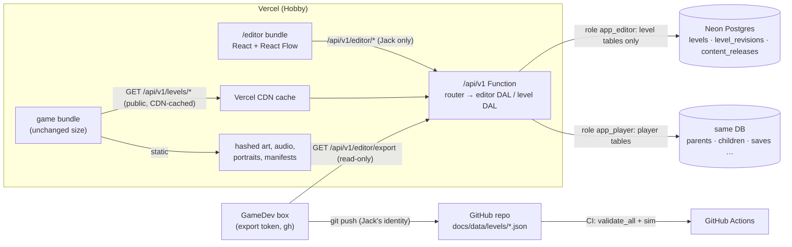

# Level and script editor: design doc

**Status: 📝 PROPOSED, waiting for Jack's approval. Nothing here is built.** Written 2026-10-10 (PT) by GameDev against main `e4e6a4a`.
**Owner:** GameDev. **Content owner:** Desy. Her companion doc [design/level-json-coverage.md](../design/level-json-coverage.md) is the must-cover checklist for the schema; this doc follows her names (`level/0.1`, `levels.draft`, `draft_rev`, `published_version`, `level_revisions`, `/api/v1/editor/*`, `server/seed-levels.mjs`, `tools/level/split_levels.py` / `join_levels.py`).
**Jack's decisions applied (2026-10-10):** a level is its own zone (no zone layer, §2.4); the DB is the live source of level content, the editor and backend have no GitHub write access, and GameDev exports published levels into the repo from its box (§9).

## Contents

0. [What Jack saw on Vercel (factual answer)](#0-what-jack-saw-on-vercel-factual-answer)
1. [Goals, non-goals and the recommendation](#1-goals-non-goals-and-the-recommendation)
2. [The level JSON schema (`level/0.1`)](#2-the-level-json-schema-level01)
3. [DB tables](#3-db-tables)
4. [Editor auth](#4-editor-auth)
5. [Editor UI and library](#5-editor-ui-and-library)
6. [Save, validate, publish, rollback](#6-save-validate-publish-rollback)
7. [Runtime load path](#7-runtime-load-path)
8. [Migrating Desy's v3.9.x data](#8-migrating-desys-v39x-data)
9. [Source of truth: DB live, repo export by GameDev](#9-source-of-truth-db-live-repo-export-by-gamedev)
10. [Rollout, risks, security and privacy](#10-rollout-risks-security-and-privacy)
11. [Open questions for Jack (with defaults)](#11-open-questions-for-jack-with-defaults)
12. [Schema questions for Desy](#12-schema-questions-for-desy)

---

## 0. What Jack saw on Vercel (factual answer)

**Short version: nothing is broken. The graph world sits behind a flag, and on Vercel a guest gets the classic world by default.** Checked in the code and in headless Chrome against `https://chinese-rpg.vercel.app` on 2026-10-10 at about 09:30 PT. The probe signed in to nothing and created no accounts.

**The code.** `src/world/mode.ts` reads the mode once at load:
1. In the accounts build only (`__CLOUD__`, which Vercel sets): if `localStorage["chinese-rpg-cloud"]` holds a `childId`, the mode is **graph**, with no exceptions.
2. Otherwise `?world=graph|classic` wins, and **the choice is remembered** in `localStorage["chinese-rpg-world-mode"]`.
3. Otherwise it uses the stored choice, and the default is **classic**.

`src/main.ts` then calls `startGraph()` or `town()` after `accountBoot()` (`src/ui/account.ts`), and `pickChild()` writes the child marker and reloads, so rule 1 applies to every child profile.

| Path | What Jack sees (observed) | Graph, scene, NPCs, quests? |
|---|---|---|
| **Guest, plain URL** (what Jack did) | Title screen (`Play as guest` / `Parent sign-in`) → "Grown-ups first!" consent → the **classic town**: Inn, Equip, Shop, Words, Gate, Magic, Quests board, Adventure. `GET /api/v1/me` → 401 as expected. Mode not set. | **No.** This is the classic prototype, by design. |
| **Guest, `/?world=graph`** | Title → consent → "What's your name?" → the **realm 1 node graph** (`data-graph` realm_1; landmarks village, m_fork, m_crow, c_den, w_throne are visible, the rest is fog; exit button and "Go in") with the **opening scene `sc_r1_opening`** playing over it (portraits, "Little Hill Village. Today is Probe's birthday.", the egg hatches, Xiaolong says **你好!** with the gloss "hello!", a choice), then the tutorial rabbit battle. `world/graphs/realm_1.json` on Vercel is **byte-identical** to the repo and holds NPC node `m_farm` (Farmer Li) with quest offers `m_farm.1`, `m_farm.2` and `w_path.1`. The choice sticks: later visits without the parameter stay in graph mode until `?world=classic`. | **Yes**, the same as the GitHub build. The probe saw the graph and the opening scene. It did not walk to `m_farm` (it's under fog at the start), but the data and code are identical to Pages. |
| **Signed-in child** | Forced into graph mode. Simulated without signing in by setting only the local child marker: the game went straight to the name prompt, then the graph and the opening scene, with the "signed out" banner because there was no session. A real child gets the same thing without the banner. | **Yes**, always. |

**Real gaps (none of them a bug):**
- A guest on Vercel can reach the graph world **only** through the URL parameter. No button offers it.
- A parent trying the game as a guest sees classic, while their children see graph.
- The fog hides `m_farm` at the start, so in the first minute "NPC interactions" means only the opening scene.

Jack's plan covers all three: graph becomes the Vercel default **after** the editor exists (§10, phase 7).

## 1. Goals, non-goals and the recommendation

**Goals**
- **One editor at `/editor` on Vercel.** Only Jack can sign in. With it Jack can:
  - draw and edit graphs (nodes, links, mazes, Desy's existing 36 levels);
  - choose what each node is (village or town, portal, treasure, NPC, quest battle, item, story, nothing…);
  - write dialogue (speaker, portrait expression, Chinese plus English gloss, no pinyin);
  - pick each level's word pool, enemies, boss, backdrop, music and encounter odds;
  - Save, then Publish.
- **One JSON object per level** holds everything the level needs: the graph, events, node quest-state variants, the quests given there, and dialogue scenes. It refers to assets by id only.
- **The game loads published levels from the API**, caches them, and keeps working offline.
- **Live saves keep working** through edits: ids are stable and are never reused.
- **Still $0** on Vercel Hobby and Neon Free.

**Non-goals**
- Editing balance: enemy stats, boss HP, prices and the 3-new-words cap stay global tables in the repo. Desy's rule; encounter odds are the one per-level exception Jack asked for (§2.4).
- Editing curriculum contents. Levels **pick** pool ids and item ids.
- Uploading art or audio from the editor. Assets stay static and versioned with the build (D5). The editor picks from the asset manifest.
- Multi-user editing, comments, or branching drafts. There is one editor (Jack).
- Any change to the battle engine, or new quest mechanics. Variants compile to today's events (Desy §2).

### 1.1 Recommendation in 10 lines

1. **Schema `level/0.1`:** one level = one graph = its own zone (36 levels). It holds per-level settings (pool, roster, boss, backdrop, music, odds), nodes, edges, events, node `quests[]` variants, quests given here, and scene/0.2 dialogue.
2. **Ids are append-only:** never reused and never renamed after publish (the game doesn't apply `renames`).
3. **DB:** `levels` (draft + published JSON, `draft_rev`, `published_version`), append-only `level_revisions`, `content_releases`, `editors`, `editor_tokens`. Under 100 MB for years.
4. **Auth:** the existing Auth.js Google sign-in, plus an `editors` allowlist checked in a separate editor DAL, kept apart from parent and child data by a separate Postgres role.
5. **UI:** React + React Flow (`@xyflow/react`) in a **separate Vite entry** (`editor.html`). The game bundle grows by 0 bytes.
6. **Validators** ported to TypeScript (ajv + zod) run in the browser and in the Function. A CI parity test against Desy's Python validators keeps them aligned.
7. **Flow:** autosave a draft (never blocked), then Publish (blocked by errors) in one transaction that bumps the version and writes a revision and a `content_release`. Rollback = republish an old revision.
8. **Runtime:** `GET /api/v1/levels/index` (short CDN cache) plus `GET /api/v1/levels/:id?v=N` (immutable, CDN-cached), an IndexedDB cache, neighbour preload, and the bundled last export as the offline fallback.
9. **Source of truth:** the DB is live. GameDev's box pulls the read-only export and commits `docs/data/levels/` with gh, so git keeps the history and the backup, and CI and the sim read it. The DB wins; repo changes return only through a deliberate import.
10. **Rollout in 7 phases, about 6–8 weeks of agent work.** Graph becomes the Vercel default only after the editor ships. The zone code is removed in phase 6.

---
