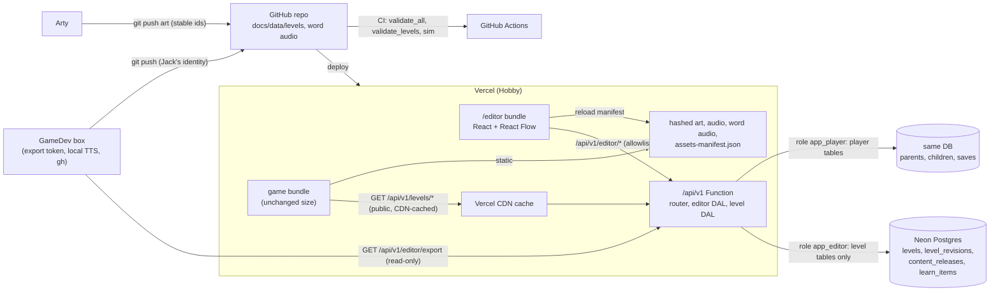
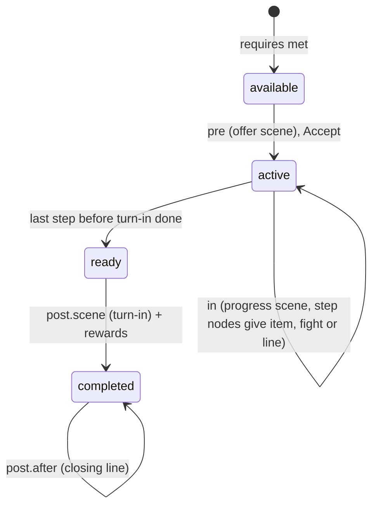
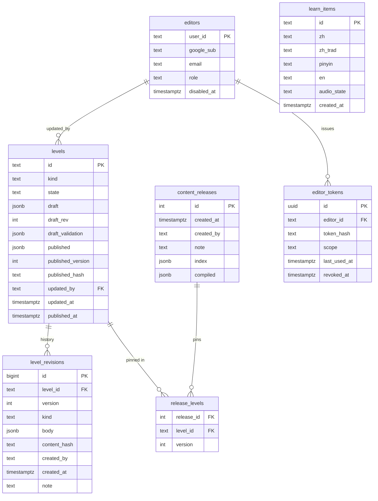
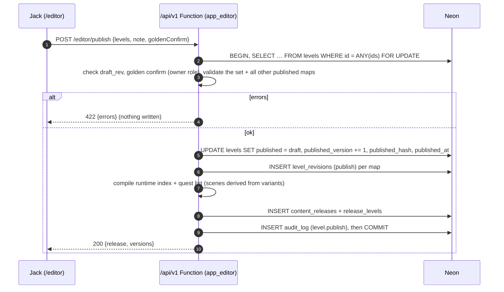
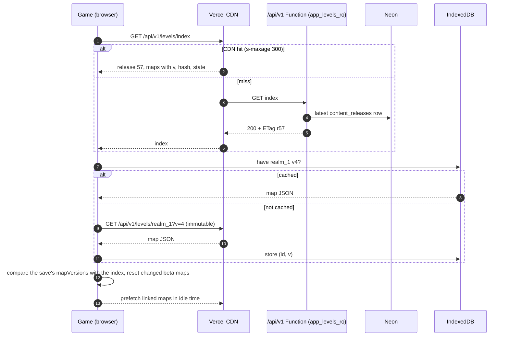
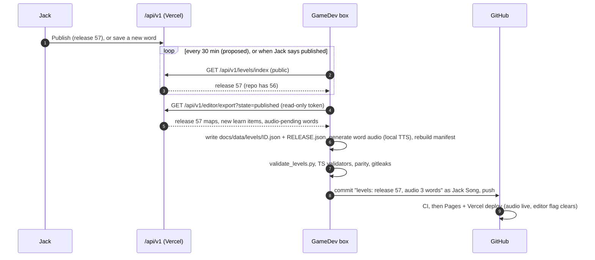

# Level and script editor: design doc

**Status: 📝 PROPOSED, waiting for Jack's approval. Nothing here is built.** First written 2026-10-10 (PT) by GameDev against main `e4e6a4a`. **Revision r1, 2026-10-11 (PT):** Jack's round-1 review applied, against main `3ab6924` plus Desy's `handoff_maps` (`level/0.2`, 38 maps in `docs/data/levels/`).
**Owner:** GameDev. **Content owner:** Desy. Her companion doc [design/level-json-coverage.md](../design/level-json-coverage.md) is the must-cover checklist and the conversion record; this doc uses her names and her schema [`docs/data/levels/schemas/level.schema.json`](../data/levels/schemas/level.schema.json) (`level/0.2`). GameDev leads the final schema.
**Standing rule (Jack, 2026-10-11):** no mechanic, system or rule that Jack hasn't approved. Anything unclear is in the open questions (§13), not in the design.

### Jack's round-1 decisions applied in r1 (2026-10-11)

| # | Decision | Where |
|---|---|---|
| R1 | Guests and signed-in players are the same: everyone gets the graph world; guests save locally only. The "classic for guests" phase is gone. | §10.2, [architecture.md §12.1](architecture.md#121-guest-mode-kept-d9) |
| R2 | Each map has its own pool of learn items, edited in the editor and pre-filled by Desy. Global word bank, validation, auto TTS audio, mastery by global id, the met rule. | §2.5 |
| R3 | Art: Arty commits art under stable ids, Vercel redeploys, the editor reloads the asset manifest. No upload. | §2.7 |
| R4 | No realms, no fixed map count: maps linked by portals, unlimited. No `realm`, no `world` kind, no `realms[]`. Per-map gold unit, `recLevel`, tier, difficulty row and boss record. Progression is by links only: no boss-gated unlocks; skipping a boss is fine. | §2.1, §2.3, §2.4 |
| R5 | Quest gates (Jack's explicit exception): optional `lockedUntilQuest` and `lockedScene` on any node or edge. | §2.6.1 |
| R6 | Per-map lifecycle draft / beta / golden replaces append-only ids and `retired`; beta reset; golden edits need Jack's confirm; hidden tester debug menu. | §2.9, §4 |
| R7 | "Top level" is renamed "Map header fields". | §2.1 |
| R8 | Game rules: no boss retry or checkpoint; no random elites (the 9 elites are placed mini-bosses only); no battle budget, no pre-boss practice patrols, no guaranteed fight after empty steps; walked edges at 50% of the normal chance; blank nodes allowed. | §1.2 |
| R9 | Hidden node types: every unvisited node looks the same in the game until the player arrives. The editor shows everything. | §11 |
| R10 | Desy's earlier gap items that still apply: scenes on variants only, no quest `zone`, no node `zone`/`boss`, `old_mine_1/npc_1`, `event: nothing` + `objective: reach`, two background ids, the danger-only odds override, Feathers as boss rewards, boss chest ≠ node event, the global data list, zh optional in the mock-up, the `town` kind, seeding from `docs/data/levels`. | §2 throughout |

## Contents

0. [What Jack saw on Vercel (Oct 10, historical)](#0-what-jack-saw-on-vercel-oct-10-historical)
1. [Goals, non-goals and the recommendation](#1-goals-non-goals-and-the-recommendation)
2. [The map JSON schema (`level/0.2`)](#2-the-map-json-schema-level02)
3. [DB tables](#3-db-tables)
4. [Editor auth, roles and the tester debug menu](#4-editor-auth-roles-and-the-tester-debug-menu)
5. [Editor UI and library](#5-editor-ui-and-library)
6. [Save, validate, publish, rollback](#6-save-validate-publish-rollback)
7. [Runtime load path and saves](#7-runtime-load-path-and-saves)
8. [Seeding from Desy's maps](#8-seeding-from-desys-maps)
9. [Source of truth: DB live, repo export by GameDev](#9-source-of-truth-db-live-repo-export-by-gamedev)
10. [Rollout, risks, security and privacy](#10-rollout-risks-security-and-privacy)
11. [Game graph renderer: hidden nodes and fog](#11-game-graph-renderer-hidden-nodes-and-fog)
12. [Engine changes the new rules need (later, separate task)](#12-engine-changes-the-new-rules-need-later-separate-task)
13. [Open questions for Jack](#13-open-questions-for-jack)
14. [Follow-ups for Desy](#14-follow-ups-for-desy)

---

## 0. What Jack saw on Vercel (Oct 10, historical)

Checked on 2026-10-10 at about 09:30 PT in headless Chrome against `https://chinese-rpg.vercel.app` (no sign-in, no accounts created). Kept as the record of how the code behaves **today**; R1 changes the plan, not this observation.

- `src/world/mode.ts` picks the mode once at load: a cloud child (`localStorage["chinese-rpg-cloud"].childId`, accounts build only) always gets **graph**; otherwise `?world=graph|classic` wins and is remembered in `localStorage["chinese-rpg-world-mode"]`; otherwise the default is **classic**.
- So a **guest on the plain URL** sees the classic town (Inn, Equip, Shop, Words, Gate, Magic, Quests board, Adventure). A guest with `/?world=graph` gets the realm-1 node graph, the opening scene `sc_r1_opening` and the tutorial battle, byte-identical to the GitHub build. A signed-in child always gets graph.
- Nothing was broken. **With R1, every player gets the graph world** (guests save locally only), so the classic default goes away when the graph world ships from the DB (§10.1 phase 2). What happens to existing classic saves is open (§13 Q4).

## 1. Goals, non-goals and the recommendation

**Goals**
- **One editor at `/editor` on Vercel.** Jack signs in and can:
  - draw and edit maps (nodes, links, mazes) and create as many maps as he likes, linked by portals, stairs and exits;
  - choose what each node is (village or town, inn, portal, treasure, NPC, quest battle, mini-boss, item, story, boss, or **blank**);
  - edit each map's **pool of learn items** (§2.5) and its settings (gold unit, recommended level, tier, difficulty row, enemies, boss, backgrounds, music, optional danger odds);
  - write dialogue (speaker, portrait expression, optional Chinese plus English gloss, no pinyin);
  - set quest gates on nodes and edges (§2.6.1);
  - move each map through **draft → beta → golden** (§2.9), then Save and Publish.
- **One JSON object per map** (`docs/data/levels/<map>.json`): its header, settings, graph, events, node quest-state variants, the quests given there and its dialogue scenes. Assets by id only.
- **The game loads published maps from the API**, caches them, and keeps working offline. Every player, guest or signed in, plays the same maps.
- **Still $0** on Vercel Hobby and Neon Free (TTS audio included, §2.5.4).

**Non-goals**
- Editing global balance: enemy stats, boss HP, prices, the 3-new-words-per-battle cap and the global encounter defaults stay global tables in the repo. The per-map danger-odds override is the one exception (§2.4).
- Uploading art or audio from the editor (R3, §2.7). Word audio is generated on GameDev's box, not uploaded (§2.5.4).
- Multi-user editing, comments or branching drafts.
- Designing new game mechanics. The editor writes the data the game runs; the rule changes in §1.2 are Jack's, and their engine work is a separate task (§12).

### 1.1 Recommendation in 10 lines

1. **Schema `level/0.2`** (Desy's): one map per file, a **map header**, one `settings` block (word pool, gold unit, tier, difficulty, enemies, boss, backgrounds, music, optional odds), nodes, edges, events, node `quests[]` variants, the quests given there, and scene/0.2 dialogue. No realms; any number of maps.
2. **Per-map lifecycle** `draft` / `beta` / `golden` replaces append-only ids: a change to a beta map resets players' progress on that map; golden maps are locked and change only with Jack's confirm.
3. **Learn items:** one global word bank with stable ids; each map has an ordered pool that Jack edits; mastery is keyed by the global id; new words get auto TTS audio from GameDev's box.
4. **DB:** `levels` (draft + published JSON, `state`, version hash), append-only `level_revisions`, `content_releases`, `learn_items`, `editors` (roles owner, tester, viewer), `editor_tokens`. Under 100 MB for years.
5. **Auth:** the existing Auth.js Google sign-in plus an allowlist with roles, checked in a separate editor DAL and a separate Postgres role. Golden-map edits need the **owner** role (Jack), checked on the server.
6. **UI:** React + React Flow (`@xyflow/react`) in a separate Vite entry (`editor.html`); the game bundle grows by 0 bytes.
7. **Validators** ported to TypeScript, checked in CI against Desy's `validate_levels.py`, run in the browser and in the Function.
8. **Flow:** autosave drafts (never blocked), Publish (blocked by errors) in one transaction; rollback = republish an old revision.
9. **Runtime:** `GET /api/v1/levels/index` + `GET /api/v1/levels/:id?v=N` (CDN-cached), IndexedDB, the bundled last export as the offline fallback. Saves record each map's version hash for the beta reset.
10. **Source of truth:** the DB is live; GameDev's box exports published maps, new learn items and generated word audio to the repo with gh (cadence: every 30 minutes, **not yet confirmed by Jack**).



### 1.2 Game rules this design follows (Jack, 2026-10-11)

The editor, the validators and the renderer plan follow these and nothing that contradicts them. The engine changes they need are listed in §12 and come in a separate task, after Desy's simplified spec.

- **No boss retry or checkpoint.** After a loss, a boss fight starts fresh, like any fight. There is no checkpoint field anywhere in the map format.
- **No random elites.** The 9 elite enemies (`role = elite` in `enemies.csv`) exist only as **fixed, placed mini-bosses**: a node fight the author places (mini-boss or quest fight). The roster has no elite slot, no elite chance and no scripted path elite.
- **No battle budget, no pre-boss practice patrols, and no guaranteed fight after empty steps** (no pity). An edge step rolls its encounter chance and nothing else changes it.
- **Walked edges** roll at **50%** of the normal encounter chance (a global number in `world_rules`, not per map).
- **Blank nodes.** Any node may have no event at all. "Blank" is a first-class choice in the editor, and no validator requires an event.
- **Progression by links only.** A map opens when a link to it can be walked. No link is gated on a boss; a boss can be skipped. Quest gates (§2.6.1) are the one exception Jack made.
- **Hidden node types until visited** (§11).

---

## 2. The map JSON schema (`level/0.2`)

`level/0.2` is Desy's schema (`docs/data/levels/schemas/level.schema.json`), drafted from `level/0.1` minus realms, `retired`, `idxMax`, elites and the boss checkpoint, plus `state` and `settings.words`. It becomes `level/1.0` when the editor ships to Jack. "Level" in file and table names means **map**.

### 2.1 Map header fields

Every map file starts with a few header fields that say what the map is and where a player arrives. They are just the header of that one map's file: there is no separate world record, no realm and no list of maps inside a map (the map list is `index.json`, compiled per release).

| Field | Type | Notes |
|---|---|---|
| `schema` | `"level/0.2"` | |
| `id` | `^[a-z0-9_]+$` | The map id (`realm_1`, `old_mine_1`, `clover_hills`). The `realm_N` ids are only names now. Free while the map is draft or beta, frozen on golden (§2.9). |
| `version` | int | Set by the server on publish. Read-only in the editor. Saves compare the **version hash** (§2.9). |
| `state` | `draft` · `beta` · `golden` | §2.9. The 38 converted maps are `beta`. |
| `kind` | `overworld` · `dungeon_level` · `town` | **No `world` kind** (R4): the world map is an ordinary map of portals. The `town` kind (a walk-in town map) is fine and allowed. Desy's `level/0.2` still lists `world`, and `world.json` uses it (§14 F1). |
| `dungeon`, `level`, `levels`, `optional` | as graph/0.3 | A multi-floor dungeon = several maps sharing `dungeon`; the editor groups them. `level` is the depth, which raises the encounter rate by the global `world_rules.depthStep` per level below 1 (the depth step stays global). |
| `title` | `{zh?, zhTrad?, en}` | |
| `entry` | node id | Where a portal without a node lands, and where a beta reset puts a player (§2.9). |
| `aspect` | number | Width/height; node x/y are 0–1 against it. |
| `settings` | object | Per-map settings (§2.4). |
| `nodes`, `edges`, `events` | arrays | §2.2–2.3. `events` keeps list order (first eligible wins). |
| `quests` | array | Quest definitions **given on this map** (§2.6). |
| `scenes` | `{id: scene/0.2}` | Every scene that triggers on this map (§2.8). |
| `characters`, `npcs`, `assets` | computed | Character refs and asset ids, recomputed on save for preload. |

**Gone from the header:** `realm`, `status`, `idxMax`, `edgeIdxMax`, `retired`, `realms[]` and the `world` kind.

### 2.2 Nodes

Fields as graph/0.3 with Desy's names: `id`, `idx`, `kind`, `x`, `y`, `title`, `save`, `services`, `hub`, `town`, `shops`, `campfire`, `npc`, `fog`, `inBuild`, plus `quests[]` (variants, §2.6). **Removed:** node `zone` and node `boss` (the boss is `settings.boss.node`). **Added by R5** (in Desy's follow-up handoff, §14 F2): optional `lockedUntilQuest` and `lockedScene` (§2.6.1).

Jack picks what happens at a node; the editor writes the data:

| Jack picks | Writes |
|---|---|
| **Blank** | any `kind` (usually `waypoint` or `fork`) and **no event**. Valid everywhere (R8). |
| Village / Town | `kind: village` / `kind: town` + `town: N` (shop catalogue), `services` |
| Inn / campfire | `kind: inn` (+ `campfire: true`) |
| Portal to another map | `kind: portal` (or `stairs_up` / `stairs_down`) plus a **cross-map edge pair** (§2.3). The target dropdown lists every map and its nodes. |
| Treasure | `kind: chest` + event `{on: enter, once: true, outcome: treasure, do: [{openChest: chest_normal}]}` (chest tables in `chest_contents.csv`) |
| NPC | `kind: npc`, `npc: <character id>`, + `{on: talk, do: [{scene: …}]}` |
| Mini-boss (placed) | `kind: miniboss` + a `fight` event or a quest step variant. The only place an elite enemy may appear (R8). |
| Quest battle | a quest step variant whose `in` holds the `fight` (outcome `miniboss`) |
| Item | event `{outcome: item, do: [{giveItem: …}]}` |
| Story event | `kind: story` + `{outcome: story, do: [{scene: …}]}` |
| Boss | `kind: boss`; the map's `settings.boss.node` points here. Its chest is `settings.boss.reward`, **never** also a node event (§2.4). |
| Lever, shop, exit | as graph/0.3 |

`old_mine_1/npc_1` stays a **campfire inn** that also carries **Miner Gao's giver variant** (Desy's D3); the editor shows the inn with an NPC badge.

### 2.3 Edges and encounters

Fields: `id`, `idx`, `from`, `to`, `kind` (`path`, `stairs`, `portal`, `exit`, `shortcut`, `oneway`), `danger` 0–3, `steps`, `terrain`, `patrol`, `cond`, `opens`, `label`, `note`, plus the optional quest-gate fields (§2.6.1). **No `scripted`** (R8: no scripted path fights or elites).

- **Danger is the encounter rule per edge.** Each step rolls the chance for its danger from the global `world_rules` defaults, raised per depth level by the global depth step and capped at the global max. A map may override **only the danger odds** (`settings.encounters`, §2.4). Walked edges roll at 50% of that chance (R8). Nothing else changes a roll (no budget, no pity).
- `patrol: true` marks the boss's gate edge (Desy's field name): no random rolls on it. No practice patrols fire there (R8).
- **Cross-map edges** (stairs, portals, exits) have `to: {graph, node}` and are stored on both maps; the editor creates, retargets and deletes the pair together. An `exit` edge may be one-way (today's `warren/x_w_throne`).
- **Links are the only progression (R4).** An edge `cond` must not use `bossDefeated`, and `settings` has no unlock list. Desy's converted maps still carry 19 boss-gated link conditions (16 on `world`, plus `realm_1/x_m_crow_clover_hills`, `clover_hills/x_c_den_warren` and `warren/x_w_throne`); they come out in her follow-up (§14 F3), and the validator turns them into errors after that. `bossDefeated` stays valid in event and scene conditions (for example a line that changes after the boss falls), because those don't unlock anything.
- **Links** (Jack's word) are not stored separately; the editor lists a map's cross-map edges as its links.

### 2.4 Per-map settings and the boss

Exactly Desy's `settings` block (R4):

```json
"settings": {
  "title": {"en": "Gloomy Village", "zh": "灰雾村"}, "emoji": "🕯️",
  "background": {"map": "bg_map_old_mine_1", "battle": "bg_battle_r6"},
  "desyPool": "L6.1",
  "words": ["C357", "C358", "C359"],
  "G": 45, "recLevel": [13, 16], "gearTier": 6,
  "difficulty": {"mcOptions": 5, "reviewSlots": 2, "pathFights": 8},
  "enemiesPerBattle": [3, 3],
  "roster": [{"enemy": "zombie", "weight": 1}], "packs": {},
  "encounters": null,
  "maxHopsToInn": 5
}
```

(`old_mine_1` as converted; `words` trimmed from 60 ids.)

| Setting | Meaning | Editable |
|---|---|---|
| `title`, `emoji` | the location name shown in battle | yes |
| `background` | **two ids**: `map` (the map screen backdrop) and `battle` (the battle backdrop) | yes, from the asset manifest (§2.7) |
| `music` | music id | yes |
| `words` | the map's **ordered pool of learn items** (§2.5) | yes |
| `desyPool` | provenance only: the curriculum list the pool was pre-filled from | read-only |
| `G` | the map's **gold unit**: prices, rewards and drops on this map | yes |
| `recLevel` | `[min, max]` recommended level (EXP and the gear check) | yes |
| `gearTier` | the map's **tier**: gear tier of chests and drops and the recommended-gear check | yes |
| `difficulty` | the **difficulty row**: `mcOptions`, `reviewSlots`, `pathFights`, copied from `realm_location_difficulty.csv` at conversion, now stored per map | yes |
| `enemiesPerBattle`, `roster` (enemy + weight), `packs` | enemy **ids** only; no `elite`, no `scriptedElite` | yes |
| `encounters` | `null` = global odds. An object overrides **only the danger odds**, e.g. `{"danger": {"1": 0.5}}`, clamped to the global max. The depth step and the walked factor stay global. | yes |
| `maxHopsToInn` | inn-distance authoring check per map | yes |
| `boss` (optional) | the **boss record**: `node`, `gateEdge` (its one `patrol` edge), `kind` (`locboss` / `realmboss`), `enemy`, `reward` (the boss chest). At most one per map. | yes |

- **Boss rewards.** The boss chest is `settings.boss.reward`. The Return Feather in the boss chests of today's realm 3, 6 and 8 bosses (`bazaar_cellars_1`, `moonlit_crypt_2`, `undercroft_3`) belongs in that `reward` on those maps. A boss chest **must not also be a node event**; the converted maps still give the Feather from an `on: clear` event (`boss_3.1`, `boss_6.1`, `boss_8.1`), which moves into `reward` in Desy's follow-up (§14 F4). Whether the Feather stays at all is still Jack's (Desy's Q-J9).
- **Bosses don't unlock anything** (R4). Beating a boss records it (`zonesDefeated`, holding boss map ids), shows it as beaten on the map, and opens its chest once; a kid can walk past an unbeaten boss to anything the links allow.
- **No battle budget** (R8), so there is no budget id and no budget reset.

### 2.5 Learn items: the global word bank and per-map pools (R2)

#### 2.5.1 Global word bank vs per-map pools

- **Global word bank = every learn item, each with a stable global id.** Today that is `docs/data/curriculum/curriculum.csv` (`C001` …): simplified, traditional, pinyin (data only, never shown in the game), English meaning, type and levels. An id is never reused or renumbered, in any map state.
- **New learn items** made in the editor (Jack types the Chinese and the English meaning; the editor suggests pinyin with the `pinyin-pro` library already in the repo, and Jack can correct it) are stored in the DB table `learn_items` with the next free id from the server, so ids stay unique and stable. GameDev's export writes them to the repo with the maps (§9.2). Where they land in the repo is §13 Q8.
- **Per-map pool = `settings.words`**, an ordered list of global ids (review order). Jack adds, removes and reorders ids per map. Desy pre-filled every pool from today's lists (`curriculum_location_pools.csv`, the map's location list, in curriculum order; dungeon floors each got their own copy; `world` is empty).
- The same id may sit in several pools (dungeon floors share lists today); the editor shows "also in: …" for each word.

#### 2.5.2 Validation

| Check | Level |
|---|---|
| unknown id (not in the word bank) | error |
| **duplicate** id inside one pool | error (the schema already says `uniqueItems`) |
| **new-words cap**: the global cap of 3 new words per battle stays a battle rule, not editable here. The editor shows each map's count of new words (pool words not met on any map reachable earlier, §2.5.5). Whether that count gets a warning threshold, and which, is §13 Q9. | info (warning once Jack sets a number) |
| **density**: each scene's lines against its declared density level (`D1`–`D3`: share of lines with a word token, at most 3 `teaches`), as `validate_dialogue.py` does today. A line with no `zh` is valid and counts as a line without a token. | error, as today |
| a word with no **meaning** (English) or no Chinese | error |
| a word with no **pinyin** | warning (pinyin is data only, but the TTS check uses it) |
| a word with no **audio** yet | flag "audio pending" on the word (not an error; §2.5.4) |
| a scene token `{Cxxx}` not met (§2.5.5) | warning on the scene line |

#### 2.5.3 Proficiency

- **Mastery is keyed by the global learn-item id** (the player's `word_mastery` rows and the local `prog` already key on the curriculum id) and **carries across maps**: a word mastered on one map counts as known on every map whose pool holds it.
- **When a word is removed from a pool:** the player's mastery of it is kept (never deleted); the word stops appearing in that map's battles; it still appears on any other map that holds it; if it's added back later, the old mastery applies again. A quest `words` step that counts answers to that map's words counts from the current pool. Scenes that used the word may now fail the met rule; the editor shows the warning.

#### 2.5.4 New-word audio (auto TTS, $0)

- **What happens:** a new learn item gets an auto-generated TTS clip, added to the static assets as `vo/<id>` (the `vo` section of `public/assets-manifest.json`; `src/engine/voice.ts` already plays `vo/<itemId>` when the manifest lists it and falls back to browser TTS otherwise).
- **The editor has no GitHub write**, so the audio is made and committed by **GameDev's box**:
  1. On save or publish, the server marks a new or changed word `audio: pending` in `learn_items`.
  2. The box's export routine (§9.2) also reads the pending list (ids, Chinese and pinyin only) with the same read-only token.
  3. The box generates the clips with a **free, local TTS engine** (no paid API and no API key; the engine is picked in phase 5 after a licence check), writes them under `public/audio/vo/`, rebuilds the manifest, and commits them **in the same commit as the export**.
  4. The push redeploys Vercel. The editor reloads the manifest (§2.7); when the manifest lists the id, the flag clears.
- **Until then** the editor shows "🔈 audio pending" on the word and on every scene line that uses it. Publishing is not blocked: the game falls back to browser TTS, as it does for every word today (the `vo` list is empty now).
- **Cost:** $0. The box does the work; the clips are small static files on the CDN.

#### 2.5.5 The met rule

A word counts as **met** for a scene if it is in the pool of **any map reachable by the time the scene can fire**. "Reachable" is a property of the data, not of one player's history: walk the links from the start (`index.json start`); a quest gate (§2.6.1) is passable only from the point where its quest can be completed; a scene can fire once its map is reachable and its trigger condition can hold. The validator computes this on save and in CI, and every player gets the same answer.

Because progression is by links only (R4), most maps are reachable early, so most words count as met early. Desy's current walk (`world_loader.unlock_order`) still treats unbeaten bosses as walls; it changes with her follow-up (§14 F3).

### 2.6 Quests and node quest-state variants

- **Ownership:** a quest definition (quest/0.2: objectives, rewards, `requires`, `words`) lives in the **giver's map** (`quests[]`). Steps name their place as `{graph, node}` on any map. **No quest `zone`, `realm`, `pool` or `hook`.**
- **Scene ids are stored only on the variants.** A node's `quests[]` holds `{quest, role, step?, pre, in, post}`, and each part holds `scene`, `after` or `events`. The quest's `scenes {offer, progress, turnIn}` are **derived** from the giver's variant at compile time and are not stored or shown twice (Desy's D5). The converted maps still carry quest `scenes` so the engine runs unchanged; they go in Desy's follow-up (§14 F5).
- **Objectives:** a step that only asks the player to get somewhere is `event: "nothing"` with `objective: {type: "reach"}`. There is no `event: "reach"`, and no `event: "portal"` (the converted maps still use it on some steps, §14 F5).

| Jack's state | Runtime state | Variant part | What plays |
|---|---|---|---|
| pre-quest | available, not started | `pre` | offer scene → `offerQuest` |
| in-quest | `active` | `in` (giver) / `in` (role `step`) | progress scene; at step nodes the item, fight or line |
| ready | `ready` (`questReady`) | `post.scene` | turn-in scene, then the rewards once |
| done | `completed` | `post.after` | the closing line on later visits |



#### 2.6.1 Quest gates (R5, Jack's explicit exception)

- **Fields.** Any node or edge may carry:
  - `lockedUntilQuest: <questId>` (optional): the node or edge is closed until that quest is completed;
  - `lockedScene: <sceneId>` (optional): the scene that plays when the player tries to pass.

  These are the field names Jack gave. Desy's `handoff_maps` diff doesn't include them yet; **her follow-up handoff adds them** to the schema and validator (§14 F2), and the editor uses exactly her field names.
- **With no `lockedScene`**, the game shows a default blocked line. Example: a broken bridge edge with `lockedUntilQuest` set to the workers' materials quest shows a "the bridge is broken" line until that quest is done, then opens.
- **Validator:**
  - the quest exists (on any map);
  - the quest's **giver and every step** (and its turn-in) can be reached from the start **without crossing this gate**;
  - **no circular locks** (gate A needs a quest whose steps sit behind gate B, which needs a quest behind gate A): checked as a cycle in the gate → quest → gate graph;
  - `lockedScene`, if set, exists.

### 2.7 Assets by id only (R3)

- A map holds only ids: `background.map`, `background.battle`, `music`, character ids + expressions, enemy ids, item and gear ids, and word audio by learn-item id.
- **Art comes from Arty through GitHub:** Arty commits art under stable ids, the push redeploys Vercel, and the deploy builds the asset manifest (`public/assets-manifest.json` plus the portrait and sprite indexes).
- **The editor reloads the manifest** (on open, on focus, and with a "Reload assets" button, fetched with `cache: no-store`) to fill its pickers. There is **no upload** in the editor.
- An id the current deploy doesn't know is a validation error, so a map can't publish ahead of its art.

### 2.8 Dialogue scenes (scene/0.2) and global data

**Scenes** keep the scene/0.2 format (`slots` L1/L2/R1/R2, lines `{id, speaker, side, expr, en, zh?, zhTrad, tokens, …}`). `speaker` and `char` are character ids; `expr` is one of 7 expressions; `zhTrad` is generated on save (OpenCC s2tw); there is **no pinyin field**; no scene `realm` or `zone` (the trigger map is implied). `zh` is optional on every line.

**Global data stays in the repo** and ships with the deploy, so the validators and the pickers use the same versions:
- `world_rules.json` (encounter defaults, depth step, walked factor);
- the curriculum: `curriculum.csv` (the word bank) and the **pool CSV** `curriculum_location_pools.csv` (provenance of the pre-filled pools);
- `enemies.csv`, combat data, `boss_hp.csv`;
- economy, items, gear, spells, towns, and **`chest_contents.csv`** (chest tables);
- the **difficulty CSV** `realm_location_difficulty.csv` (provenance of the per-map difficulty rows);
- the characters registry and `progress.schema.json`;
- plus the editor-made learn items once exported (§2.5.1).

### 2.9 Map lifecycle: draft, beta, golden (R6)

Replaces append-only ids, `idxMax` / `edgeIdxMax` and `retired`.

| State | Who plays it | Edits | Effect on players |
|---|---|---|---|
| `draft` | nobody (editor playtest only) | free; ids free | none. A link into a draft map stays closed for players. |
| `beta` | every player and tester; progress is saved | free; ids and idx may change | publishing a change **resets players' progress on that map** (below) |
| `golden` (published) | every player | **locked.** An edit needs Jack's explicit approval: a confirm step only his account can do, checked on the server by role (§4.1) | no reset |

**Detecting a change:** every publish stores the map's **version hash** (SHA-256 of the canonical JSON, `levels.published_hash`). A save records the hash it last played per map (`mapVersions {mapId: hash}`). On load, and at the next map change when a new release arrives mid-session, every **beta** map whose hash differs is reset.

**What a beta reset does** (Desy §5): it clears that map's fog bitsets, events done, visit and crossing counters, shortcuts and edge progress, and moves a player standing on the map to its `entry`. **Every quest given on that map goes back to not-started, whatever state it was in** (Jack). Gold, gear, EXP, spells and other maps stay.

**Working defaults for the reset** (the Director's, **not locked** by Jack, §13 Q3):
- a completed quest's reward can be earned again after a reset;
- quests given on other maps are not affected, even if they have steps on the reset map;
- quest items the player holds stay with the player.

Still open: whether the map's boss is un-defeated (Desy's Q-J3b, default no).

**Ids:** unique within a map. On draft and beta maps ids and idx may change (the reset clears that map's bitsets); on golden maps the editor shows them read-only. RNG keys hash ids (`saveSeed|mapId|edgeId|crossing|step`), so a reset map replays like a fresh save.

### 2.10 Full example

A trimmed `old_mine_1` as converted, in the r1 shape (quest scenes on the variant only; step `s1` as `nothing` + `reach`). It has no boss of its own.

```json
{
  "schema": "level/0.2",
  "id": "old_mine_1",
  "state": "beta",
  "kind": "dungeon_level",
  "dungeon": "old_mine", "level": 1, "levels": 1, "optional": true,
  "title": {"zh": "旧矿洞 第1层", "en": "Old Mine (optional) - level 1"},
  "entry": "stairs_1",
  "aspect": 3.515,
  "settings": {
    "title": {"en": "Gloomy Village", "zh": "灰雾村"}, "emoji": "🕯️",
    "background": {"map": "bg_map_old_mine_1", "battle": "bg_battle_r6"},
    "desyPool": "L6.1", "words": ["C357", "C358", "C362", "C378", "C381", "C401", "C406"],
    "G": 45, "recLevel": [13, 16], "gearTier": 6,
    "difficulty": {"mcOptions": 5, "reviewSlots": 2, "pathFights": 8},
    "enemiesPerBattle": [3, 3], "roster": [{"enemy": "zombie", "weight": 1}], "packs": {},
    "encounters": null, "maxHopsToInn": 5
  },
  "nodes": [
    {"id": "stairs_1", "idx": 0, "kind": "stairs_up", "x": 0.05, "y": 0.5, "title": {"zh": "楼梯", "en": "Entrance"}},
    {"id": "path_1", "idx": 1, "kind": "fork", "x": 0.23, "y": 0.5, "title": {"en": "Dark hall"}},
    {"id": "deadend_1", "idx": 6, "kind": "miniboss", "x": 0.59, "y": 0.35, "title": {"en": "Mini-boss lair"},
     "quests": [{"quest": "q6_old_mine", "role": "step", "step": "s3",
                 "in": {"events": [{"id": "deadend_1.q", "node": "deadend_1", "on": "enter", "outcome": "miniboss",
                                    "do": [{"fight": {"enemies": ["zombie", "zombie", "zombie_knight"], "kind": "miniboss"}, "quest": "q6_old_mine"}]}]}}]},
    {"id": "npc_1", "idx": 9, "kind": "inn", "campfire": true, "save": true, "services": ["inn", "save", "potions"],
     "x": 0.59, "y": 0.65, "title": {"zh": "营火", "en": "Campfire inn"},
     "quests": [{"quest": "q6_old_mine", "role": "giver",
                 "pre":  {"scene": "sc_q6_old_mine_offer"},
                 "in":   {"scene": "sc_q6_old_mine_wait"},
                 "post": {"scene": "sc_q6_old_mine_thanks"}}]}
  ],
  "edges": [
    {"id": "x_stairs_1", "idx": 0, "from": "stairs_1", "kind": "stairs", "to": {"graph": "realm_6", "node": "portal_2"}},
    {"id": "e1", "idx": 1, "from": "stairs_1", "to": "path_1", "kind": "path", "danger": 2, "steps": 1, "terrain": "tunnel"},
    {"id": "e6", "idx": 6, "from": "path_1", "to": "deadend_1", "kind": "path", "danger": 1, "steps": 1, "terrain": "tunnel"}
  ],
  "events": [],
  "quests": [
    {"schema": "quest/0.2", "id": "q6_old_mine", "story": "side", "type": "rescue",
     "title": {"zh": "老矿井", "en": "Trapped in the Old Mine"},
     "giver": {"npc": "miner_gao", "graph": "old_mine_1", "node": "npc_1"},
     "turnIn": "giver", "requires": null, "order": "sequence", "repeatable": false,
     "objectives": [
       {"id": "s1", "event": "nothing", "objective": {"type": "reach"}, "where": {"graph": "realm_6", "node": "portal_2"}},
       {"id": "s2", "event": "quest_offer", "objective": {"type": "talk", "npc": "miner_gao"}, "where": {"graph": "old_mine_1", "node": "npc_1"}},
       {"id": "s3", "event": "miniboss", "objective": {"type": "kill", "enemies": ["zombie", "zombie", "zombie_knight"]}, "where": {"graph": "old_mine_1", "node": "deadend_1"}}],
     "rewards": {"gold": {"G": 7}, "exp": {"L": 25}, "items": {"honey": 1}},
     "words": ["C362", "C378", "C381", "C401", "C406"]}
  ],
  "scenes": {
    "sc_q6_old_mine_offer": {
      "schema": "scene/0.2", "id": "sc_q6_old_mine_offer", "density": "D3",
      "trigger": {"graph": "old_mine_1", "node": "npc_1", "on": "questOffer"},
      "slots": {"L1": {"char": "hero", "expr": "neutral"}, "R1": {"char": "miner_gao", "expr": "sad"}},
      "lines": [
        {"id": "l1", "speaker": "miner_gao", "side": "R1", "expr": "sad", "en": "Help! My friends are stuck behind the zombies."},
        {"id": "l2", "speaker": "miner_gao", "side": "R1", "expr": "surprised", "zh": "我很害怕。", "en": "I'm very scared."}]}
  }
}
```

Notes: the mini-boss fight with `zombie_knight` (an elite) is a **placed** fight, which R8 keeps. `npc_1` is the campfire inn with Miner Gao's giver variant. The quest has no `scenes` block (derived from the variant). Line `l1` has no `zh`, which is valid and passes the density check.

### 2.11 Mapping from today's formats

| Today | level/0.2 | Status |
|---|---|---|
| graph/0.3 header (`realm`, `status`, `idxMax`, `edgeIdxMax`, `background`) | map header without them; `background {map, battle}` in settings | done by `convert_levels.py` |
| `zones.json` zone record | `settings` per map; `boss` only on the boss map | done; `elite`, `scriptedElite` dropped |
| `world.json realms[]` | dropped; the world map is ordinary portals | done; its boss conds and `world` kind: §14 F1, F3 |
| tier-derived `G`, `recLevel`, difficulty row | stored per map | done |
| node `zone`, node `boss`; edge `scripted` | dropped | done |
| inline graph `dialogue{}` | `scenes{}`; `{dialogue}` → `{scene}` | done |
| quest `zone`, `realm`, `pool`; quest `scenes` | dropped; scenes derived from variants | `zone` done; `scenes`: §14 F5 |
| quest `event: portal` | `event: nothing` + `objective: reach` | §14 F5 |
| `index.json renames` | dropped; the index is compiled per release | done |

---

## 3. DB tables

Migration `003_levels.sql`. Content tables only, with **no child or parent columns**. (Table names keep "level" = map.)



- **`levels`**: one row per map: current draft, current published copy, `state`, and `published_hash` (the version hash saves compare, §2.9). `draft_rev` is the optimistic lock (§6.4). No `realm` column.
- **`level_revisions`**: append-only. `kind = 'publish'` (one per publish, never pruned), `'checkpoint'` (a draft snapshot at most every 10 minutes, pruned after 90 days by the existing daily cron), `'golden-unlock'` (Jack's confirm, §4.1).
- **`content_releases`** + **`release_levels`**: the published set, with the compiled index and quest list, so the public index route is one row read.
- **`learn_items`**: words made in the editor (§2.5.1), `audio_state` ∈ `pending`, `ready`. The ids continue the global numbering. The curriculum rows stay in the repo; the server reads them from the deploy for validation.
- **`editors`**: the allowlist, `role` ∈ `owner` (Jack), `tester`, `viewer` (export only). See §4.1.
- **`editor_tokens`**: hashed read-only tokens, `scope = 'export:read'` (§9).
- **`audit_log`** (exists): adds `actor_type 'editor'` and the actions `editor.signin`, `level.save` (sampled), `level.publish`, `level.state`, `level.golden_unlock`, `level.rollback`, `level.import`, `export.read`, `token.create`, `token.revoke`, `debug.use`.
- **Seed:** the tables are seeded from `docs/data/levels/` (§8).

**Size:** a map is about 30–60 KB raw with scenes and quests (about 15 KB compressed). 38 maps plus 2,000 publish revisions, 2,000 checkpoints and 2,000 releases stay **well under 100 MB**, next to player data at about 0.25–0.5 MB per active child. Unlimited maps (R4) grow this by about 30 KB per new map plus its revisions.

---

## 4. Editor auth, roles and the tester debug menu

- **Same Auth.js, same Google provider, same session cookie.** After sign-in the router builds one of two disjoint contexts: **`EditorCtx`** (the session's user has a live `editors` row, or matches the bootstrap env var `EDITOR_GOOGLE_SUBS`) or **`ParentCtx`** (unchanged). Editor routes accept only `EditorCtx`; no request is both.
- **The role check is in the DAL**: `server/dal/levels.ts` takes a branded `EditorCtx` and re-checks the role in every function.
- **A separate Postgres role** `app_editor`: `select, insert, update` on the level tables, `insert` only on `level_revisions` and `audit_log`, `select` on `users`, `accounts` and `sessions`, and **no grant on any player table**. The public level routes use the read-only role `app_levels_ro`.
- **CSRF** checks as today (same-origin `Origin`, not `Sec-Fetch-Site: cross-site`, `application/json`, `X-App-Request: 1`); sessions stay SameSite=Lax and httpOnly.
- **Step-up:** publish, rollback, import, token creation and the golden confirm need a session younger than 12 hours.
- **Rate limits** per editor: save 240/h; publish, rollback and import 30/h; export 60/h per token.

### 4.1 Roles and the golden lock

| Role | Can |
|---|---|
| `owner` (Jack) | everything: edit, change state, publish, roll back, import, tokens, **confirm golden edits**, grant the tester role |
| `tester` | play beta maps and use the in-game debug menu (§4.2); no editor writes |
| `viewer` | export only (the token's identity) |

**Golden lock.** Saving a draft over a golden map, publishing it, or moving it out of golden is refused unless the request carries a **golden confirm** made by an `owner`. The editor asks Jack to confirm ("This map is golden. Change it?"); the server checks that the session's role is `owner` (with step-up), writes a `golden-unlock` revision and an audit row, and allows that change. No other role can do it, even with a crafted request.

### 4.2 Hidden in-game debug menu (testers)

Planned, not built:
- **Who:** signed-in accounts whose Google `sub` has `role = tester` (or `owner`). The game learns the role from `GET /api/v1/me`; the server decides. Guests never see it.
- **What:** set quest states (not started, active at a step, ready, done) and other progress (bosses beaten, visited nodes, flags, items); **jump to any map and node**; play **beta** maps (drafts stay in the editor playtest).
- **How it ships:** a separate lazy chunk loaded only after the server confirms the role and opened by a hidden gesture, so the players' game bundle doesn't grow. Each debug action is written to the audit log (`debug.use`, no content). It acts on the tester's own save.

---

## 5. Editor UI and library

### 5.1 Library choice

| Option | Verdict |
|---|---|
| **React Flow (`@xyflow/react`, MIT)** | **Recommended.** Drag, connect, multi-select, minimap, zoom, custom node components and edge labels out of the box; forms are plain React. React ≈ 60 KB gz + React Flow ≈ 50 KB gz. |
| Rete.js | a dataflow editor: the wrong model for a map |
| Cytoscape.js | a good viewer, weak as an editor |
| Custom canvas / Phaser, vanilla SVG | weeks of DIY hit-testing, selection, undo and forms |

### 5.2 A separate bundle (the game grows by 0 bytes)

- Vite input `{ main: 'index.html', editor: 'editor.html' }` with `src/editor/main.tsx`; React and React Flow are imported only from `src/editor/**`.
- Shared code (schema types, validators, the condition evaluator) lives in `src/shared/level/**`.
- The editor entry is built only when `VITE_CLOUD_SAVE=1`, so the Pages build stays byte-identical.
- `vercel.json` rewrites `/editor*` → `/editor.html` with `X-Robots-Tag: noindex`; `tools/check_dist.mjs` fails the build if `react`, `@xyflow` or `src/editor` appear in the game's chunks.
- Game `index-*.js` today: 627 KB gz (measured at `e4e6a4a`), unchanged except a 3–5 KB gz shared loader. Editor: about 180–220 KB gz (estimate; measured in phase 3).

### 5.3 Layout and panels

```
┌───────────────┬──────────────────────────────────────────────┬─────────────────────────┐
│ MAPS [search] │  GRAPH CANVAS (React Flow, everything shown)  │  NODE INSPECTOR         │
│ ● realm_6   β │   ○ village ──2── ○ fork ──1── ◆ boss        │  Node npc_1 · idx 9     │
│   old_mine_1 β│        │                                     │  Kind  [Inn ▾] + NPC 🖼  │
│   clover_hil β│        0                                     │  Event [Blank ▾]        │
│ ★ warren    G │        ○ inn            ⚠ 2 warnings         │  🔒 until quest [q… ▾]   │
│ ✎ new_map   D │  [＋node] [link] [delete] [tidy] [fit]       │  Quest: [pre | in | post]│
│ [＋ New map]  │  minimap                                     │  Events (ordered) ⇅     │
├───────────────┴──────────────────────────────────────────────┴─────────────────────────┤
│ DIALOGUE  sc_q1_hoe_offer  [L1 hero] [L2 xiaolong] [R1 farmer_li · sad 🖼]                 │
│  l1 farmer_li · surprised · zh [我的锄头呢?] en [Where is my hoe?]   ↑ ↓ ✖   Preview ▶      │
│  l2 farmer_li · sad       · zh [          ] en [Have you seen it?]  zh optional ✓ density │
├─────────────────────────────────────────────────────────────────────────────────────────┤
│ MAP SETTINGS  G [45] Lv [13–16] Tier [6] Difficulty [5|2|8]  Roster [zombie ×1]          │
│  Boss [zombie_mayor ▾] at [boss_1 ▾] gate [e10 ▾] reward [..]  BG map [..] battle [..]   │
│  Odds [global ▾]  State [beta ▾]                                                         │
│ WORD POOL (60)  C357 ✓🔈 · C358 ✓🔈 · … · C901 新词 ⚠ 🔈 pending   [+ add] [new word]      │
│ [✓ autosaved 09:41]  [Validate]  [Playtest ▶]  [Publish…]  [History]  [Reload assets]    │
└─────────────────────────────────────────────────────────────────────────────────────────┘
```

- **Map list:** every map with its state badge (D draft, β beta, G golden), its error count and "draft ahead of v3"; search; grouping by dungeon; **no realm grouping and no zone layer**. "New map": pick a kind and type an id (checked unique).
- **Graph canvas:** create, drag, link and delete nodes and edges; edge labels show danger and steps; cross-map edges show as stubs (double-click jumps there); "tidy" lays out mazes; undo and redo. **The editor always shows every node's type, icon and title** (hidden types are a game-only rule, §11). Golden maps open read-only until Jack confirms (§4.1).
- **Node inspector:** kind and event in Jack's words (§2.2), **Blank** included; portal target (map → node); title; services; the ordered event list; the quest variant tabs; the **quest gate** (`lockedUntilQuest` picker and optional `lockedScene` picker; edges have the same two fields).
- **Dialogue editor:** slots with character and expression pickers and live portraits; per line the speaker, side, expression, **optional Chinese**, English gloss and `{Cxxx}` tokens (autocomplete from the word bank); density and met-rule results shown live; `zhTrad` read-only; no pinyin field; Preview ▶. A line with no Chinese is valid and passes the density check.
- **Map settings:** the §2.4 fields, including the two background pickers.
- **Word pool:** the ordered `settings.words` list with add (search by Chinese or English), remove, reorder, "also in …", the note that removing a word keeps players' mastery, and per-word status (meaning, pinyin, 🔈 audio ready or pending). **New word** creates a learn item (§2.5.1).
- **Enemy and boss pickers:** from `enemies.csv` with sprite thumbnails; elites are offered only in mini-boss and quest fights.
- **Inline validation:** errors in red and warnings in amber, on the canvas, on the field and in a problems list; the same messages as the server.
- **Playtest ▶:** opens `/?world=graph&playtest=<mapId>` in a new tab; the draft comes through `GET /api/v1/editor/levels/:id/draft`; it uses a throwaway save key `chinese-rpg-proto-v4:playtest`, never synced; the tester debug menu (§4.2) is available.

---

## 6. Save, validate, publish, rollback

### 6.1 Validators: one TypeScript port, checked against Desy's Python

`src/shared/level/validate.ts` runs in the browser and in the Function. Desy's `docs/tech/tools/levels/validate_levels.py` is the reference. Checks:
- **Schema** `level/0.2` (+ scene/0.2, quest/0.2, common) with ajv.
- **Graph:** unique ids; edge endpoints; `entry` exists; cross-map links resolve both ways (an `exit` may be one-way); every map reachable from the start by links (warning); `maxHopsToInn`; one boss and one `patrol` gate per boss map; **no `bossDefeated` in an edge `cond`** (an error once §14 F3 lands); **blank nodes allowed** (no event required).
- **Boss:** the boss node has no event that opens a chest or gives the boss reward (that belongs in `settings.boss.reward`).
- **Enemies:** elites only in placed fights (mini-boss or quest fight), never in a roster.
- **Quest gates** (§2.6.1): the quest exists; its giver, steps and turn-in are reachable without crossing the gate; no circular locks; `lockedScene` exists.
- **Quests:** positions resolve; variant ↔ step both ways; rewards are G/L multiples; `requires` has no cycles; no quest `zone`.
- **Words** (§2.5.2): known ids, no duplicates in a pool, the new-word count, missing meaning, pinyin or audio.
- **Dialogue:** the met rule (§2.5.5); density per declared level; at most 3 `teaches`; known speakers and expressions; no pinyin.
- **Lifecycle:** a golden map changes only with the owner's confirm; ids are read-only on golden maps.
- **Assets:** every id is in the deployed manifest.

**Scope:** each check runs on the map being saved **plus every other map as published**. **Parity (CI):** `tests/level-parity.mjs` runs the TypeScript port and `validate_levels.py` on `docs/data/levels/` and on known-bad fixtures, and requires the same error and warning codes.

### 6.2 Save (autosave)

Autosave runs 2 s after the last change and on blur and unload (`PUT /api/v1/editor/levels/:id/draft {draftRev, body}`). The server validates, generates `zhTrad`, recomputes `characters` and `assets`, marks new words' audio as pending, and stores the draft with `draft_rev + 1`. **Saving is never blocked by errors.** A checkpoint revision is written at most every 10 minutes. Offline, the editor keeps the unsent draft in `localStorage` and retries.

### 6.3 Publish (atomic)



- Players only ever see published content.
- **Set publish:** link pairs and cross-map quests are validated and committed together.
- **Before publishing a beta map**, the editor says plainly: "Publishing resets every player's progress on this map, and its quests go back to not-started." It shows how many saves have progress there (a count from the player-role DAL; only the number crosses over).
- **Compile** (`src/shared/level/compile.ts`): a Vercel Function can't run Python, so the runtime index and quest list are compiled in TypeScript; Desy's Python stays the CI reference.

### 6.4 Concurrency

Every save and publish carries `draftRev`; a mismatch returns **409** with the server's draft, and the editor offers "reload theirs" or "overwrite with mine". There are no merges.

### 6.5 Rollback

History lists the publish revisions and the checkpoints. "Restore to draft" copies a revision into the draft. "Roll back" republishes revision vM as version N+1 through the same validation (and the same golden confirm and beta reset notice). History is never rewritten.

---

## 7. Runtime load path and saves



### 7.1 Endpoints and caching

- **`GET /api/v1/levels/index`** (public): the release id, `{id: {v, hash, state, kind, title}}` for beta and golden maps (never drafts), the start position, and the compiled quest-list hash. `Cache-Control: public, max-age=60`, `CDN-Cache-Control: public, s-maxage=300, stale-while-revalidate=86400`, `ETag: "r<release>"`. A publish reaches players within about 5 minutes with no CDN purge.
- **`GET /api/v1/levels/:id?v=N`** (public): that version, `immutable`; without `v`, a 302 to the current one.
- **`GET /api/v1/levels/quests?r=<release>`**: the compiled quest list, immutable.
- `vercel.json`'s `no-store` for `/api/(.*)` is narrowed to exclude `/api/v1/levels/`.
- **Client cache:** an IndexedDB store `levels` keyed `(id, v)`, keeping the last 2 versions per map. **Preload:** the maps behind the current map's links, and their asset lists.

### 7.2 Offline and fallbacks

1. The IndexedDB copy named in the cached index.
2. API unreachable and no cache: the maps bundled at build time from `docs/data/levels/` (GameDev's latest export).
3. The Pages build has no API; it keeps the frozen v3.9.x seed until it's retired (§13 Q6).

### 7.3 Saves and the beta reset

- Saves gain **`mapVersions {mapId: hash}`** (Desy §5; the only new progress field the lifecycle needs), next to `dataVersion`; `saves.content_version` records the release.
- **On load** (and at the next map change after a new release), each beta map whose hash differs is reset as in §2.9. Golden maps never reset; draft maps are not in the index.
- Deleted or renumbered nodes on a beta map need no separate reconcile: the reset clears that map's bits and moves the player to `entry`. A `lastInn` on a reset map moves to its `entry` if that is a save point, else to the start.
- **One-time migration** of existing saves: `zonesDefeated` zone ids → boss map ids (Desy's 1:1 table); the realm_1 split moves bits to `clover_hills` and `warren`; `bossCheckpoint` and the budget fields are dropped. It is flagged so it runs once, and the server keeps the pre-migration save in `save_backups`.
- Cloud saves: the server-side save validator (`server/progress.ts`) reads node counts from the published release, not the bundled index.

### 7.4 Cost against the free tiers

| Item | At about 1,000 MAU | Free limit |
|---|---|---|
| Index requests | at most 1 Function call per CDN region per 5 minutes | 1M invocations |
| Map files | one miss per `(id, v)` per region | 1M CDN requests, 100 GB |
| Neon wake-ups | index misses only | 100 CU-hours (still the first limit) |
| Editor | one user | negligible |
| GameDev export + TTS | an index poll every 30 minutes, on the box | $0 |

---

## 8. Seeding from Desy's maps

The conversion is **done**. Desy's `docs/tech/tools/levels/convert_levels.py` wrote the 38 `level/0.2` maps, `index.json` and the schema into `docs/data/levels/` (`--check` reports drift), and `validate_levels.py` passes with 0 errors and 2 known warnings (the one-way `warren/x_w_throne` exit; 148 quest scene ids not written yet). The Python sim reads the same folder (`run_world_sim.py ci`).

- **The DB is seeded from `docs/data/levels/`.** `server/seed-levels.mjs` runs after `npm run db:migrate`: it loads `docs/data/levels/*.json`, validates them with the TypeScript validators, and in one transaction inserts every map as **published version 1** in its file `state` (beta), with identical drafts, one revision each (`note: "seed from docs/data/levels"`) and release 1. It refuses a non-empty table unless given `--restore` (§9.4).
- Desy's follow-up data (§14) is committed to `docs/data/levels/` before the seed if it is ready, or imported as drafts after it (§9.3).
- **Cutover check:** GameDev's first export equals the seeded files byte for byte.
- `docs/data/world/` stays **frozen** as the conversion input (CI still checks that Desy's world tools reproduce it). It retires as a runtime input once the DB is seeded.
- The r0 `split_levels.py` / `join_levels.py` round trip is no longer needed: Desy's tools read `docs/data/levels/` directly.

---

## 9. Source of truth: DB live, repo export by GameDev

Jack's decisions (2026-10-10): the editor and backend get **no GitHub write access**, and **GameDev exports** published maps into the repo from its own box with the signed-in gh CLI. The DB wins for map content; docs, code, schemas and global tables stay GitHub-primary.

### 9.1 Roles

| Where | Holds | Truth for |
|---|---|---|
| **Neon DB** | drafts, published maps, revisions, releases, editor-made learn items | live map content |
| **GitHub `docs/data/levels/`** | the latest published JSON per map + `RELEASE.json`, with history | history, backup, seed, recovery, CI, the sim, Desy's reading copy |
| **GitHub `public/`** | art from Arty, word audio from the box, the manifest | assets |
| **GitHub, everything else** | docs, code, schemas, validators, global tables, the frozen seed | unchanged |

### 9.2 The export loop



- **Cadence:** every 30 minutes plus on demand. **Jack hasn't confirmed this cadence** (§13 Q2).
- **The endpoint** `GET /api/v1/editor/export` is GET only and takes either Jack's editor session (the **Download JSON** button) or a Bearer token with scope `export:read`. The token can't save, publish, import or read drafts; the only draft-side data it sees is the audio-pending word list (ids, text and pinyin).
- **The credential lives only on GameDev's box** (`~/.config/chinese-rpg/export-token`, mode 600, outside every repo): never in the repo, in Actions, in a URL or in a log; hashed at rest; revocable. gitleaks runs before every export commit and again in CI.
- **The commit** touches only `docs/data/levels/**`, the learn-items file (§13 Q8) and `public/audio/vo/**` + the manifest. Author `Jack Song <48544849+zenjax7@users.noreply.github.com>`, pushed to `main`, which deploys Pages and Vercel. If the validators fail on an export, GameDev still commits it (the repo mirrors what players see) and flags it to Jack as a parity bug.

### 9.3 Conflict rules

- **The DB wins.** Each export overwrites `docs/data/levels/`.
- Repo edits reach the DB only through a deliberate **import** (`POST /api/v1/editor/import`, editor session; it lands as the draft with a diff view, and Jack publishes).

### 9.4 Backups and disaster recovery

Three layers: Neon's restore window, `level_revisions`, and the git history. `server/seed-levels.mjs --restore` loads the repo copy into a fresh database. Local dev seeds PGlite from the same files.

---

## 10. Rollout, risks, security and privacy

### 10.1 Phases

Sizes: S ≈ up to 2 days, M ≈ 3–5 days, L ≈ 1–2 weeks of agent work.

| # | Phase | Size | Done when |
|---|---|---|---|
| 0 | This doc approved by Jack; Desy's follow-up (§14) lands | S | Jack approves; the decisions.md lines move from proposed to decided |
| 1 | Final `level/0.2` schema; TypeScript validators + compile; parity with `validate_levels.py` in CI | L | parity green; 0 errors on `docs/data/levels/` |
| 1b | **Engine rule changes** (§12): a separate task, after Desy's simplified spec | M | the engine follows §1.2; the TS sim parity test matches `run_world_sim.py` |
| 2 | `003_levels.sql` + roles; `seed-levels.mjs`; public routes; the game loads maps from the API with IndexedDB and the bundled fallback; `mapVersions` + the beta reset; save migration; **the graph world for every player** (guests save locally) | M–L | a Vercel preview plays from the DB for a guest and a child; reset and migration tests pass |
| 3 | Editor MVP: auth and roles, `editor.html`, map list, canvas, inspector, map settings, word pool, autosave, 409, bundle guard | L | Jack edits and saves a draft; the game bundle's sha is unchanged |
| 4 | Dialogue editor, quest view and variants, quest gates, learn items, inline validation, Playtest, tester debug menu | L | Jack writes a quest with a gate end to end and plays it from the draft |
| 5 | Publish (single and set), lifecycle states and the golden confirm, releases, history, rollback, import, the export endpoint and tokens; GameDev's export + TTS routine | M | a publish reaches players within 5 minutes; the export commit with audio lands and CI is green |
| 6 | Remove the zone and realm code (`src/world/engine.ts`, `src/ui/graph.ts`, `src/world/content.ts`, `src/data.ts`, `src/world/progress.ts`, `src/engine/battle.ts`, `server/progress.ts`, `server/dal/saves.ts`, the tests); retire `docs/data/world/` as a runtime input | M | `rg -n "zone|realm" src server` finds only migration aliases |

There is no separate "classic for guests" phase (R1).

**Campaign sim:** Desy's Python sim is back (`docs/tech/tools/sim/run_world_sim.py`; `ci` mode in about 10 s). A headless TypeScript sim that reuses the game's real modules stays planned for after the engine changes, with a parity test against `run_world_sim.py` (default options = Jack's rules).

### 10.2 Guests and signed-in players (R1)

- **Everyone gets the graph world**, from the same published maps.
- **Guests save locally only** (the same `progress` shape as an account save, `mapVersions` included). The beta reset runs on load exactly as for accounts.
- Clearing the browser, another device or private mode loses a guest's progress. The grown-ups banner keeps suggesting a free family account, and the existing one-time import moves a guest save into a child profile on sign-up.
- No server record of a guest (architecture §12.1).
- Existing classic saves: §13 Q4.

### 10.3 Risks

| Risk | Mitigation |
|---|---|
| The TypeScript port drifts from `validate_levels.py` | the parity test on every push |
| A beta publish wipes a child's progress on that map unexpectedly | the publish notice with the affected-save count; golden for finished maps; quests on other maps unaffected (default) |
| Links-only progression lets kids walk into maps far above their level | `recLevel` shown on the map; Jack can change links or add quest gates; Desy's sim re-run (§14 F3) shows the effect |
| Unvisited node types leak through client data (§11) | the DOM/SVG never carries the type of an unvisited node; the JSON stays readable in devtools (accepted risk) |
| A golden map edited by mistake | owner-only confirm, step-up, audit, rollback |
| A new word's TTS clip is wrong (bad pinyin guess, wrong tone) | Jack sees the pinyin and plays the clip in the editor; an edit regenerates it |
| The CDN doesn't cache function responses as expected | checked on a preview in phase 2; fallback: static files rebuilt by a deploy hook |
| Neon paused or over quota | IndexedDB and the bundled fallback for players; the editor keeps unsent drafts |
| A stolen Google session | allowlist by `sub`, 12-hour step-up, audit, rollback |
| The export token leaks | it reads only data that is already public, plus pending word text; revocable |

### 10.4 Security and privacy notes

- **The editor never touches child data** (types, DAL, Postgres grants). The only cross-touch is the affected-save **count** at publish.
- **The tester debug menu** is server-gated by role, loaded only after the role check, audited, and acts only on the tester's own save.
- **Map content and word lists are public data** with no personal data in them.
- **No secrets in the repo:** `.env.example` gets `DATABASE_URL_EDITOR`, `DATABASE_URL_LEVELS_RO`, `EDITOR_GOOGLE_SUBS` and `EXPORT_TOKEN_PEPPER`; the values live in Vercel. The export token lives only on GameDev's box; there is no GitHub credential in Vercel or the backend.
- CSP is unchanged for `/editor`.

---

## 11. Game graph renderer: hidden nodes and fog

This is the renderer plan for the game's map screen (`src/ui/graph.ts`, and `fog()` in `src/world/engine.ts`), updated for R9. The fog-of-war rules in [design/world-graph.md](../design/world-graph.md) (§0.1, §12, §13 answer 3) carry the same rule.

- **In the game, every unvisited node looks identical:** the same neutral marker, with no kind icon, no title, and no colour, size or shape difference. A node's **type and icon are revealed only when the player arrives** there (its `visited` bit is set). This sits **on top of** fog of war, which still decides which unvisited nodes are drawn at all (the neighbours one open edge away, as "?").
- **Landmarks:** today towns, villages and bosses (`fog: "landmark"`) are drawn with their icon and title once their area is open. Under R9 they look like every other unvisited node until visited. Whether a landmark still shows its **position** early is §13 Q5.
- **The editor shows everything** to Jack: every type, icon, title and event, fogged or not. The editor playtest and the tester debug menu follow the game's rules.
- **Client-side data should not leak the type of an unvisited node:**
  - **Feasible, and required:** the rendered DOM/SVG for an unvisited node carries no kind, title or kind-specific class. Today `graph.ts` writes `data-kind="<kind>"` on every drawn node, "?" nodes included, and shows landmark titles; both change in the engine task (§12).
  - **Not feasible without a server round-trip:** removing kinds from the map JSON itself. The game runs arrivals and events in the browser and must work offline and for guests with no server state, so it downloads the full map JSON (node kinds, events, quests), which a curious player can read in devtools. **Accepted risk** for a kids' game (§10.3).

---

## 12. Engine changes the new rules need (later, separate task)

Not part of this docs change. Done after Desy's simplified spec arrives. Line numbers are at main `3ab6924`.

| Rule | Files |
|---|---|
| No boss checkpoint | `src/engine/battle.ts` 64, 358–359, 534 (`bossCheckpoint`, `bossCheckpointFrac`); `src/engine/state.ts` 10; `src/ui/graph.ts` 123; `src/ui/screens.ts` 413, 561; `src/world/engine.ts` 48, 55; `src/world/progress.ts` 55; `balance.json bossCheckpointFrac`; `progress.schema.json bossCheckpoint` |
| No random elites | `src/engine/battle.ts` 74 (`eliteReplaceChance`, `loc.elite`); `balance.json learning.eliteReplaceChance`; `src/data/locations.json elite` |
| No scripted path fights | `src/engine/battle.ts` 62–66; `src/ui/graph.ts` 285; `src/world/engine.ts` 11 (`GEdge.scripted`); `src/world/content.ts` 16; `src/data.ts` 18 |
| No battle budget, no pity | `src/world/engine.ts` 157–159 (`zoneBattleBudget`, `budgetSpentMult`, `pityRolls`) and 48, 55 (`freshBattles`, `pity`); `src/ui/graph.ts` 282; `world_rules.json` |
| No practice patrols | `src/ui/screens.ts` 382 (`patrolsPerTrip`); `src/engine/learning.ts` 58 (patrol trigger); `src/world/engine.ts` 48, 55 (`patrolsLeft`, `approachArmed`); `src/ui/graph.ts` 350 |
| Walked edges at 50% | `world_rules.json clearedStepMult` 0.05 → 0.5 (read in `src/world/engine.ts` 157) |
| Blank nodes | confirm that arrival handling in `src/ui/graph.ts` and the event pick in `src/world/engine.ts` accept a node with no events |
| Links-only progression | `src/world/engine.ts` 100 (`bossDefeated` on edges) and 116–118 (`realmOpen`); `src/ui/graph.ts` 361 and 379–383 (world-map realm locks) |
| Quest gates | `src/world/engine.ts` (`edgeOpen` and a node-entry check for `lockedUntilQuest`); `src/ui/graph.ts` (the default blocked line or `lockedScene`) |
| Hidden node types | `src/world/engine.ts` 125–134 (`fog`, landmark kinds); `src/ui/graph.ts` 391–396 (`data-kind`, icon, label) |
| Map lifecycle | `src/world/progress.ts` (`mapVersions`, beta reset); `server/progress.ts`; `server/dal/saves.ts`; `src/net/cloud.ts` 60 |
| Guests in graph | `src/world/mode.ts` 1–14 (classic default); `src/main.ts` |
| Maps from the API | `src/world/content.ts`, `src/data.ts`, and a new `src/shared/level/**` loader |

---

## 13. Open questions for Jack

1. **Approve the overall plan?** Not yet approved; this doc stays PROPOSED and nothing is built.
2. **The 30-minute export cadence** for GameDev's box (§9.2): not yet confirmed. *Default:* poll every 30 minutes, export only when the release changes, plus "published" on request.
3. **The beta-reset defaults** (§2.9) are the Director's and not locked: a completed quest's reward can be earned again; quests given on other maps are unaffected; quest items stay. Also Desy's Q-J3b: does a reset un-defeat the map's boss? *Default:* no.
4. **Existing classic saves** (guests who played classic before R1): do they get a one-time "start the new world" offer, or does classic stay reachable for a while? *Default:* none set; your call.
5. **Landmarks under hidden nodes** (§11): should towns, villages and bosses still show their position early (as plain unvisited markers)? *Default:* keep today's fog visibility, with no icon or title.
6. **The Pages build** once maps live in the DB. *Default:* Pages keeps the frozen seed until you retire it.
7. **What may change on a golden map with your confirm** (Desy's Q-J3d)? *Default:* anything, but a structural change (deleting or renumbering nodes or edges) moves the map back to beta, which resets it.
8. **Where editor-made learn items land in the repo:** a file the export writes next to the maps, or merged into `curriculum.csv` by Desy? *Default:* the export writes `docs/data/levels/learn_items.csv`, and Desy folds it into the curriculum when she next edits it.
9. **A new-words threshold** for the editor's warning (§2.5.2): which number, if any? *Default:* none; the editor shows the count only.
10. **Quest `requires` with `bossDefeated`:** 17 quests are offered only after a boss is beaten. A quest offer isn't a map unlock, so they are kept until you rule. Keep them?
11. Desy's other open items ([level-json-coverage.md §8](../design/level-json-coverage.md#8-questions-for-jack-each-with-our-default): the Feather, the realm_1 split, the doorways, the starting state of the 38 maps) stand as she wrote them.

## 14. Follow-ups for Desy

Her `handoff_maps` predates part of Jack's round 1. Her next handoff brings the data, spec and sim in line:
- **F1.** Drop the `world` kind from `level/0.2` and give `world.json` an ordinary kind.
- **F2.** Add the quest-gate fields `lockedUntilQuest` and `lockedScene` to nodes and edges in the schema, and the gate checks (§2.6.1) to `validate_levels.py`.
- **F3.** Remove the 19 `bossDefeated` link conditions (16 on `world`, plus `realm_1/x_m_crow_clover_hills`, `clover_hills/x_c_den_warren` and `warren/x_w_throne`); change `world_loader.unlock_order()` and the met-rule walk to links only (no boss walls); re-run the sim.
- **F4.** Move the Feather from the boss-node `on: clear` events (`bazaar_cellars_1/boss_3.1`, `moonlit_crypt_2/boss_6.1`, `undercroft_3/boss_8.1`) into `settings.boss.reward`, and add the "boss chest is not a node event" check.
- **F5.** Replace the 9 quest steps with `event: portal` by `event: nothing` + `objective: {type: reach}`; stop storing quest `scenes` (derived from the variants).
- **F6.** Spec and sim: remove the battle budget, pity and practice patrols, set walked edges to 50%, and allow blank nodes in combat-spec, world-graph and the sim (rows 3, 5, 7 and 12 of her §9 audit are now decided by Jack). `docs/data/world/` stays frozen, so where the new global values live is hers to propose.
- **F7.** `validate_levels.py` in CI: her handoff didn't ask for it, so it isn't in `deploy.yml` yet. GameDev adds it when she agrees.
