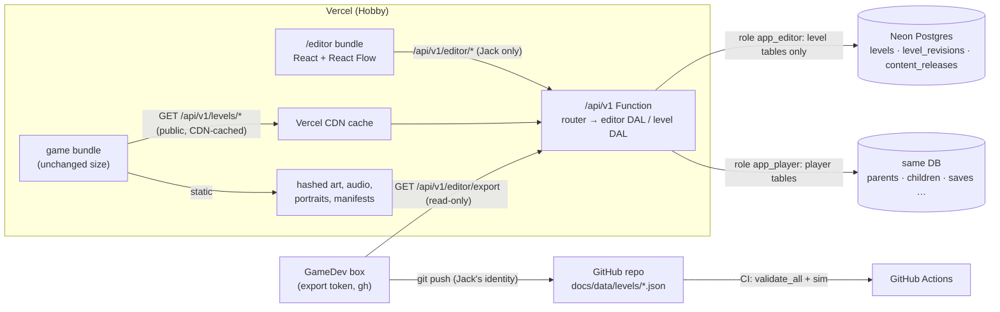

# Level and script editor: design doc

**Status: 📝 PROPOSED, waiting for Jack's approval. Nothing here is built.** Written 2026-10-10 (PT) by GameDev against main `e4e6a4a`.
**Owner:** GameDev. **Content owner:** Desy. Her companion doc [design/level-json-coverage.md](../design/level-json-coverage.md) is the must-cover checklist for the schema; this doc follows her names (`level/0.1`, `levels.draft`, `draft_rev`, `published_version`, `level_revisions`, `/api/v1/editor/*`, `server/seed-levels.mjs`, `tools/level/split_levels.py` / `join_levels.py`).
**Jack's decisions applied (2026-10-10):** a level is its own zone (no zone layer, §2.4); the DB is the live source of level content, the editor and backend have no GitHub write access, and GameDev exports published levels into the repo from its box (§9).

## Contents

0. [What Jack saw on Vercel (factual answer)](#0-what-jack-saw-on-vercel-factual-answer)
1. [Goals, non-goals and the recommendation](#1-goals-non-goals-and-the-recommendation)
2. [The level JSON schema (`level/0.1`)](#2-the-level-json-schema-level01)
3. [DB tables](#3-db-tables)
4. [Editor auth](#4-editor-auth)
5. [Editor UI and library](#5-editor-ui-and-library)
6. [Save, validate, publish, rollback](#6-save-validate-publish-rollback)
7. [Runtime load path](#7-runtime-load-path)
8. [Migrating Desy's v3.9.x data](#8-migrating-desys-v39x-data)
9. [Source of truth: DB live, repo export by GameDev](#9-source-of-truth-db-live-repo-export-by-gamedev)
10. [Rollout, risks, security and privacy](#10-rollout-risks-security-and-privacy)
11. [Open questions for Jack (with defaults)](#11-open-questions-for-jack-with-defaults)
12. [Schema questions for Desy](#12-schema-questions-for-desy)

---

## 0. What Jack saw on Vercel (factual answer)

**Short version: nothing is broken. The graph world sits behind a flag, and on Vercel a guest gets the classic world by default.** Checked in the code and in headless Chrome against `https://chinese-rpg.vercel.app` on 2026-10-10 at about 09:30 PT. The probe signed in to nothing and created no accounts.

**The code.** `src/world/mode.ts` reads the mode once at load:
1. In the accounts build only (`__CLOUD__`, which Vercel sets): if `localStorage["chinese-rpg-cloud"]` holds a `childId`, the mode is **graph**, with no exceptions.
2. Otherwise `?world=graph|classic` wins, and **the choice is remembered** in `localStorage["chinese-rpg-world-mode"]`.
3. Otherwise it uses the stored choice, and the default is **classic**.

`src/main.ts` then calls `startGraph()` or `town()` after `accountBoot()` (`src/ui/account.ts`), and `pickChild()` writes the child marker and reloads, so rule 1 applies to every child profile.

| Path | What Jack sees (observed) | Graph, scene, NPCs, quests? |
|---|---|---|
| **Guest, plain URL** (what Jack did) | Title screen (`Play as guest` / `Parent sign-in`) → "Grown-ups first!" consent → the **classic town**: Inn, Equip, Shop, Words, Gate, Magic, Quests board, Adventure. `GET /api/v1/me` → 401 as expected. Mode not set. | **No.** This is the classic prototype, by design. |
| **Guest, `/?world=graph`** | Title → consent → "What's your name?" → the **realm 1 node graph** (`data-graph` realm_1; landmarks village, m_fork, m_crow, c_den, w_throne are visible, the rest is fog; exit button and "Go in") with the **opening scene `sc_r1_opening`** playing over it (portraits, "Little Hill Village. Today is Probe's birthday.", the egg hatches, Xiaolong says **你好!** with the gloss "hello!", a choice), then the tutorial rabbit battle. `world/graphs/realm_1.json` on Vercel is **byte-identical** to the repo and holds NPC node `m_farm` (Farmer Li) with quest offers `m_farm.1`, `m_farm.2` and `w_path.1`. The choice sticks: later visits without the parameter stay in graph mode until `?world=classic`. | **Yes**, the same as the GitHub build. The probe saw the graph and the opening scene. It did not walk to `m_farm` (it's under fog at the start), but the data and code are identical to Pages. |
| **Signed-in child** | Forced into graph mode. Simulated without signing in by setting only the local child marker: the game went straight to the name prompt, then the graph and the opening scene, with the "signed out" banner because there was no session. A real child gets the same thing without the banner. | **Yes**, always. |

**Real gaps (none of them a bug):**
- A guest on Vercel can reach the graph world **only** through the URL parameter. No button offers it.
- A parent trying the game as a guest sees classic, while their children see graph.
- The fog hides `m_farm` at the start, so in the first minute "NPC interactions" means only the opening scene.

Jack's plan covers all three: graph becomes the Vercel default **after** the editor exists (§10, phase 7).

## 1. Goals, non-goals and the recommendation

**Goals**
- **One editor at `/editor` on Vercel.** Only Jack can sign in. With it Jack can:
  - draw and edit graphs (nodes, links, mazes, Desy's existing 36 levels);
  - choose what each node is (village or town, portal, treasure, NPC, quest battle, item, story, nothing…);
  - write dialogue (speaker, portrait expression, Chinese plus English gloss, no pinyin);
  - pick each level's word pool, enemies, boss, backdrop, music and encounter odds;
  - Save, then Publish.
- **One JSON object per level** holds everything the level needs: the graph, events, node quest-state variants, the quests given there, and dialogue scenes. It refers to assets by id only.
- **The game loads published levels from the API**, caches them, and keeps working offline.
- **Live saves keep working** through edits: ids are stable and are never reused.
- **Still $0** on Vercel Hobby and Neon Free.

**Non-goals**
- Editing balance: enemy stats, boss HP, prices and the 3-new-words cap stay global tables in the repo. Desy's rule; encounter odds are the one per-level exception Jack asked for (§2.4).
- Editing curriculum contents. Levels **pick** pool ids and item ids.
- Uploading art or audio from the editor. Assets stay static and versioned with the build (D5). The editor picks from the asset manifest.
- Multi-user editing, comments, or branching drafts. There is one editor (Jack).
- Any change to the battle engine, or new quest mechanics. Variants compile to today's events (Desy §2).

### 1.1 Recommendation in 10 lines

1. **Schema `level/0.1`:** one level = one graph = its own zone (36 levels). It holds per-level settings (pool, roster, boss, backdrop, music, odds), nodes, edges, events, node `quests[]` variants, quests given here, and scene/0.2 dialogue.
2. **Ids are append-only:** never reused and never renamed after publish (the game doesn't apply `renames`).
3. **DB:** `levels` (draft + published JSON, `draft_rev`, `published_version`), append-only `level_revisions`, `content_releases`, `editors`, `editor_tokens`. Under 100 MB for years.
4. **Auth:** the existing Auth.js Google sign-in, plus an `editors` allowlist checked in a separate editor DAL, kept apart from parent and child data by a separate Postgres role.
5. **UI:** React + React Flow (`@xyflow/react`) in a **separate Vite entry** (`editor.html`). The game bundle grows by 0 bytes.
6. **Validators** ported to TypeScript (ajv + zod) run in the browser and in the Function. A CI parity test against Desy's Python validators keeps them aligned.
7. **Flow:** autosave a draft (never blocked), then Publish (blocked by errors) in one transaction that bumps the version and writes a revision and a `content_release`. Rollback = republish an old revision.
8. **Runtime:** `GET /api/v1/levels/index` (short CDN cache) plus `GET /api/v1/levels/:id?v=N` (immutable, CDN-cached), an IndexedDB cache, neighbour preload, and the bundled last export as the offline fallback.
9. **Source of truth:** the DB is live. GameDev's box pulls the read-only export and commits `docs/data/levels/` with gh, so git keeps the history and the backup, and CI and the sim read it. The DB wins; repo changes return only through a deliberate import.
10. **Rollout in 7 phases, about 6–8 weeks of agent work.** Graph becomes the Vercel default only after the editor ships. The zone code is removed in phase 6.



---

## 2. The level JSON schema (`level/0.1`)

The version is `level/0.1` (Desy's name). It becomes `level/1.0` when the editor ships to Jack. The JSON Schema lives in the repo at `docs/data/levels/schemas/level.schema.json`, next to the shared `common.schema.json` (conditions and actions), `scene.schema.json` and `quests.schema.json`.

### 2.1 Top level

| Field | Type | Notes |
|---|---|---|
| `schema` | `"level/0.1"` | |
| `id` | `^[a-z0-9_]+$` | Equals today's graph id (`realm_1`, `old_mine_1`, `world`). **Permanent.** |
| `version` | int | Set by the server on publish (`published_version`). Read-only in the editor. |
| `kind` | `world` · `overworld` · `dungeon_level` · `town` | `town` is new and optional, for a walk-in town map later. Today towns are nodes. |
| `realm` | 0–9 | 0 for `world` |
| `dungeon`, `level`, `levels`, `optional` | as graph/0.3 | A multi-floor dungeon = several levels sharing `dungeon`. The editor groups them. |
| `title` | `{zh, zhTrad?, en}` | |
| `status` | `reference` · `authored` | Desy Q7: a level Jack edits becomes `authored` |
| `entry` | node id | The arrival node |
| `aspect` | number | Width/height. Node x/y are normalised 0–1 against it. |
| `idxMax`, `edgeIdxMax` | int | Only grow (§2.9) |
| `retired` | `{nodes[], edges[], events[], quests[], scenes[]}` | Deleted ids, never handed out again |
| `settings` | object | **The per-level settings that replace zones** (§2.4) |
| `boss` | object or `null` | **The level's location or realm boss** (§2.4) |
| `realms` | array | Only in `world`: realm links, as today's `world.json` |
| `nodes`, `edges`, `events` | arrays | §2.2–2.3. `events` keeps list order, because order is data (first eligible wins). |
| `quests` | array | Quest definitions **given in this level** (§2.6) |
| `scenes` | object `{id: scene/0.2}` | Every scene that triggers in this level, inline graph dialogue included (§2.5) |
| `characters` | string[] | Character ids used here (refs into the global registry); computed on save |
| `assets` | object | `{backgrounds[], music[], portraits[], sprites[]}` ids; **computed on save** from the content, used for preload (§7) |
| `legacy` | `{zones: string[]}` | Old zone ids this level absorbed, used only for save migration (§2.4) |

### 2.2 Nodes

As graph/0.3, with the same field names (Desy's rule):
- `id`, `idx`, `kind`, `x`, `y` (0–1, the editor keeps 0.05–0.95), `title`;
- `save`, `services`, `hub`, `town`, `shops`, `campfire`, `npc`, `fog`, `inBuild`.

The `zone` field is **removed** (§2.4). One field is **added**: `quests[]`, the quest-state variants (§2.6).

Jack's "what happens here" maps to `kind` plus the node's first event. The editor offers the friendly menu on the left and writes the data on the right:

| Jack picks | Writes |
|---|---|
| Village / Town | `kind: village` / `kind: town` + `town: N`, `services` |
| Inn / campfire | `kind: inn` (+ `campfire: true`) |
| Portal to another map / dungeon | `kind: portal` (or `stairs_up` / `stairs_down`) plus a **cross-level edge pair** (§2.3). The target dropdown lists published and draft levels and their nodes. |
| Treasure | `kind: chest` + event `{on: enter, once: true, outcome: treasure, do: [{openChest: chest_normal}]}` |
| NPC encounter | `kind: npc`, `npc: <character id>`, + event `{on: talk, do: [{scene: …}]}` |
| Quest battle | `kind: miniboss` + a quest step variant whose `in` is `{do: [{fight: {...}, quest}], outcome: miniboss}` (pick the quest and step) |
| Item | event `{outcome: item, do: [{giveItem: …}]}` |
| Story event | `kind: story` + event `{outcome: story, do: [{scene: …}]}` |
| Location boss | `kind: boss`; the level's `boss.node` points here |
| Nothing / path | `kind: waypoint` or `fork`, with no event |
| Lever, shop, exit | as graph/0.3 |

### 2.3 Edges and encounters

As graph/0.3:
- `id`, `idx`, `from`, `to`, `kind` (path, stairs, portal, exit, shortcut);
- `danger` 0–3, `steps`, `terrain`, `patrol`;
- `scripted {enemies, fill, once, step}`, `cond`, `opens`, `label`.

Rules:
- **Danger is the encounter rule per edge.** Per-level odds (§2.4) turn danger into a chance per step; `patrol: true` marks the boss approach (no random battles); `scripted` places a fixed fight.
- **Cross-level edges** (stairs, portals, exits) have `to: {graph, node}` and are stored **on both levels**. The editor creates, retargets and deletes the pair together, and publish validates the pair as a set (§6.3).
- **Links** (Jack's word) are not stored separately; the editor shows them as the list of cross-level edges.

### 2.4 Per-level settings and the boss (a level is its own zone)

Jack's decision on 2026-10-10: **zones disappear from the schema and the editor.** Every setting a zone held is now a per-level setting:

```json
"settings": {
  "title":   {"zh": "灰雾村", "en": "Gloomy Village"},
  "tier": 6,
  "pool":    {"locations": ["L6.1"], "add": [], "remove": []},
  "roster":  [{"enemy": "zombie", "weight": 1}],
  "enemiesPerBattle": [3, 3],
  "elite": "zombie_knight", "packs": {}, "scriptedElite": null,
  "background": "bg_village_fog", "music": "village_theme",
  "encounters": null,
  "unlockRequires": ["hydra_s_lair"]
},
"boss": {"node": "boss_1", "gateEdge": "e10", "enemy": "zombie_mayor", "kind": "locboss", "id": "gloomy_village"}
```

(These are `realm_6`'s settings, taken from today's `gloomy_village` zone; the background and music ids are illustrative.)

- **`pool`**: curriculum location ids (`L1.1`…`L9.2`, from `curriculum_location_pools.csv`), plus optional `add` / `remove` lists of curriculum item ids (`C001`…). Default (Desy Q4): pick location ids only, with add and remove hidden behind "advanced".
- **`roster`, `elite`, `packs`, `boss.enemy`**: enemy ids from `enemies.csv`, never copied stats. The editor warns when a boss of another tier or type is picked (`boss_hp.csv`).
- **`encounters`**: `null` means the global `world_rules` odds (danger 0/0.6/0.85/0.95, depth +10% per level, max 0.95, pity 2, budget 8). An object overrides some of them, e.g. `{"danger": {"1": 0.5}}`. The validator clamps the values to the global maximum.
- **`unlockRequires`**: `boss.id` values (old zone ids keep working).
- **`boss`**: the location boss is per level (Desy). It is one record or `null`, for a level with no boss, such as most dungeon floors and the optional mines.
  - `boss.id` is **the old zone id, kept for ever**, so `bossDefeated: "warren"` conditions, `zonesDefeated` in saves and realm unlocks keep working with no save migration.
  - New levels get `boss.id = level id`.
- **Realm-boss rewards** (`bossReward`: gold, Honey Potion, the heroic piece, a skill) stay global, in the realm content tables, keyed by `boss.id`, so the reward can't be given twice.
- **How today's zones map:**
  - 14 of 20 zones span 2–5 graphs, so each such graph **inherits its zone's settings**, and the boss goes only to the level that holds `bossNode`. For example, `demon_king_s_gate` covers `realm_9`, `demon_castle_1–2` and `shadow_vault_1–2`, and its boss sits in exactly one of them.
  - 10 graphs hold 2–3 zones today. In 9 of them the second zone is a single entrance or boss node (for example, `realm_2` has 11 `forest` nodes and 1 `great_hive` node); `realm_1` has three real zones (meadow 7, clover_hills 4, warren 6 nodes).
  - **Desy's zone→level map for all 36 graphs, and her recommendation for the multi-zone graphs, are in [level-json-coverage.md](../design/level-json-coverage.md)** (being added as of 2026-10-10). This doc follows her map rather than inventing one.
- **What breaks without zones:** the code that still depends on zones:
  - `zones.json`;
  - `src/world/engine.ts`, which reads `zonesDefeated` and `z.bossKind`;
  - `src/world/content.ts`, `src/ui/graph.ts` (the zone budget and `p.zone`) and `server/progress.ts`;
  - `progress.schema.json` (`zone`, `zonesDefeated`).

  Desy is listing it. Phase 6 removes or renames it (§10).

### 2.5 Dialogue scenes (scene/0.2, unchanged)

`scenes` maps scene id → a scene/0.2 object exactly as in `docs/data/dialogue/` (Desy: no new line format):
- `slots` L1/L2/R1/R2 `{char, expr}`;
- lines `{id, speaker, side, expr, en, zh?, zhTrad, tokens, if/else, goto, end, choices…}`.

Rules:
- `speaker` and `char` are **character ids** in the global registry.
- `expr` is one of the 7 portrait expressions.
- The portrait image is resolved from the character id + expression, through `public/portraits/portraits_index.json`.
- **`zhTrad` is generated on save** (OpenCC s2tw, in the Function) and stored.
- **There is no pinyin field** (decision 18).
- `scene.zone` becomes implied by the level; `trigger.graph` must equal the level id.

### 2.6 Quests and node quest-state variants

**Ownership (decided here):** a quest definition (quest/0.2: steps, rewards, `requires`, `words`, `scenes`) is **owned by the giver's level** (`quests[]`). Every other level that takes part refers to it by id. That gives one owner, rewards in one place, and a definition that is edited where Jack meets the giver.

**Variants:** a node's `quests[]` (Desy §2.2) is keyed by quest id and role:

```json
{"quest": "q6_old_mine", "role": "giver",
 "pre":  {"scene": "sc_q6_old_mine_offer"},
 "in":   {"scene": "sc_q6_old_mine_wait"},
 "post": {"scene": "sc_q6_old_mine_thanks", "after": "sc_q6_old_mine_after"}}
```

| Jack's state | Runtime state | Variant key | What plays (compiled to today's events, no engine change) |
|---|---|---|---|
| pre-quest: meet the giver | available (`requires` met, not started) | `pre` | offer scene → `offerQuest` |
| in-quest | `active` | `in` (giver) | the progress scene ("have you done it?") |
| in-quest, at step nodes | `active` | `in` (role `step`, `step: sN`) | the quest item, the quest enemies (`fight`) or a line, gated by `questActive` |
| ready to turn in | `ready` (`questReady`) | `post.scene` | the turn-in scene, then the quest's rewards, once |
| done | `completed` (`questDone`) | `post.after` | the closing line on later visits |

```mermaid
stateDiagram-v2
  [*] --> available: requires met
  available --> active: pre (offer scene), Accept
  active --> active: in (giver progress scene; step nodes give item, fight or line)
  active --> ready: last step before turn-in done
  ready --> completed: post.scene (turn-in) + rewards from the quest definition
  completed --> completed: post.after (closing line)
```



- **Rewards live only in the quest definition**, as multiples of G and L.
- `questDone` and `questClaimed` mean the same in the engine (`src/world/engine.ts`); the editor shows "done".
- `questReady` is added to `common.schema.json` (Desy §1.7).

**Cross-level quests:** at least 13 of 50 quests have steps in another graph.
- The definition sits in the giver's level.
- Steps name their place as `{graph, node}`.
- Each step node carries a `role: step` variant in **its own** level.
- The validator checks both directions across the published set: every step has a variant, and every variant points at a real quest and step.
- A quest whose steps change in two levels is published as a **set** (§6.3).
- The editor's quest view lists the giver, the steps and the turn-in, and jumps between levels.
- At publish the server compiles the runtime quest list (quest/0.2) from all levels into the release.

### 2.7 Assets by id only

The level never holds a URL or a file name. It holds only these ids:
- `background` / `music` ids (`public/` manifests);
- character ids + expressions (`public/portraits/`);
- enemy ids (sprites via `tools/sync_sprites.sh` output);
- item and gear ids.

The editor's pickers read the same static manifests the game uses. The validator rejects unknown ids. The server computes `assets` on save for preload.

### 2.8 Global data stays global (in the repo)

These stay in the repo:
- `world_rules.json` (defaults);
- the curriculum and pools;
- `enemies.csv` / combat data / `boss_hp.csv`;
- economy, items, gear, spells and towns;
- the characters registry;
- `progress.schema.json`.

They ship with the deploy, so the Function's validators and the editor's pickers use the same versions. A level that references an id the current deploy doesn't know fails validation.

### 2.9 Stable ids, retirement and no renames

- The ids of levels, nodes, edges, events (`<node>.<n>`), quests, steps, scenes and `boss.id` are **save keys and RNG keys**. Seeds hash `saveSeed|graphId|edgeId|crossing|step` and `…|nodeId|visit`. Bitsets index by `idx`.
- New nodes and edges get `idxMax+1` / `edgeIdxMax+1`. A deleted id goes into `retired` and is never reused (the server also checks against every past revision).
- **No renames after publish.** `index.json` has a `renames` map, but **the game does not apply it** (no reference in `src/`). The policy is therefore **ids are fixed once published**:
  - before the first publish, ids are free text;
  - after it, the editor shows the id read-only and offers a free-text title instead.
  - If a rename is ever needed, implementing `renames` in `src/world/progress.ts` comes first.

### 2.10 Full example

A trimmed `old_mine_1` as it would look after migration: 6 of its 13 nodes, with a quest step, an NPC giver and one scene. It is valid against the draft schema. It's a level with no boss of its own, so it inherits the `gloomy_village` zone settings (whose boss is in `realm_6`), and `boss` is `null`.

```json
{
  "schema": "level/0.1",
  "id": "old_mine_1",
  "version": 1,
  "kind": "dungeon_level",
  "realm": 6,
  "dungeon": "old_mine", "level": 1, "levels": 1, "optional": true,
  "title": {"zh": "旧矿洞 第1层", "zhTrad": "舊礦洞 第1層", "en": "Old Mine (optional) - level 1"},
  "status": "reference",
  "entry": "stairs_1",
  "aspect": 3.515,
  "idxMax": 12, "edgeIdxMax": 13,
  "retired": {"nodes": [], "edges": [], "events": [], "quests": [], "scenes": []},
  "legacy": {"zones": ["gloomy_village"]},
  "settings": {
    "title": {"zh": "旧矿洞", "en": "Old Mine"},
    "tier": 6,
    "pool": {"locations": ["L6.1"], "add": [], "remove": []},
    "roster": [{"enemy": "zombie", "weight": 1}],
    "enemiesPerBattle": [3, 3],
    "elite": "zombie_knight", "packs": {}, "scriptedElite": null,
    "background": "bg_mine", "music": "dungeon_theme",
    "encounters": null,
    "unlockRequires": ["hydra_s_lair"]
  },
  "boss": null,
  "nodes": [
    {"id": "stairs_1", "idx": 0, "kind": "stairs_up", "x": 0.05, "y": 0.5, "title": {"zh": "楼梯", "en": "Entrance"}},
    {"id": "path_1", "idx": 1, "kind": "fork", "x": 0.23, "y": 0.5, "title": {"zh": "暗厅", "en": "Dark hall"}},
    {"id": "treasure_1", "idx": 2, "kind": "chest", "x": 0.41, "y": 0.2, "title": {"zh": "宝库", "en": "Vault"}},
    {"id": "deadend_1", "idx": 6, "kind": "miniboss", "x": 0.59, "y": 0.35, "title": {"zh": "小头目", "en": "Mini-boss lair"},
     "quests": [{"quest": "q6_old_mine", "role": "step", "step": "s3",
                 "in": {"outcome": "miniboss", "do": [{"fight": {"enemies": ["zombie", "zombie", "zombie_knight"], "kind": "miniboss"}, "quest": "q6_old_mine"}, {"setFlag": "q6_old_mine.s3"}]}}]},
    {"id": "story_2", "idx": 8, "kind": "story", "x": 0.41, "y": 0.8, "title": {"zh": "故事点", "en": "Story spot"},
     "quests": [{"quest": "q6_old_mine", "role": "step", "step": "s4",
                 "in": {"outcome": "story", "do": [{"scene": "sc_q6_old_mine_miners"}]}}]},
    {"id": "npc_1", "idx": 9, "kind": "npc", "npc": "miner_gao", "x": 0.59, "y": 0.65, "title": {"zh": "矿工", "en": "Miner Gao"},
     "quests": [{"quest": "q6_old_mine", "role": "giver",
                 "pre":  {"scene": "sc_q6_old_mine_offer"},
                 "in":   {"scene": "sc_q6_old_mine_wait"},
                 "post": {"scene": "sc_q6_old_mine_thanks", "after": null}}]}
  ],
  "edges": [
    {"id": "x_stairs_1", "idx": 0, "from": "stairs_1", "kind": "stairs", "to": {"graph": "realm_6", "node": "portal_2"}},
    {"id": "e1", "idx": 1, "from": "stairs_1", "to": "path_1", "kind": "path", "danger": 2, "steps": 1, "terrain": "tunnel"},
    {"id": "e2", "idx": 2, "from": "path_1", "to": "treasure_1", "kind": "path", "danger": 2, "steps": 2, "terrain": "tunnel"},
    {"id": "e6", "idx": 6, "from": "path_1", "to": "deadend_1", "kind": "path", "danger": 1, "steps": 1, "terrain": "tunnel"},
    {"id": "e8", "idx": 8, "from": "path_1", "to": "story_2", "kind": "path", "danger": 1, "steps": 1, "terrain": "tunnel"},
    {"id": "e9", "idx": 9, "from": "treasure_1", "to": "npc_1", "kind": "path", "danger": 1, "steps": 1, "terrain": "tunnel"}
  ],
  "events": [
    {"id": "path_1.1", "node": "path_1", "on": "enter", "pick": [
      {"weight": 70, "outcome": "nothing", "once": false, "do": []},
      {"weight": 15, "outcome": "story", "once": false, "do": [{"scene": "sc_old_mine_1_ambient"}]},
      {"weight": 15, "outcome": "item", "cooldown": 4, "do": [{"giveItem": "honey", "qty": 1}]}]},
    {"id": "treasure_1.1", "node": "treasure_1", "on": "enter", "once": true, "outcome": "treasure", "do": [{"openChest": "chest_normal"}]},
    {"id": "treasure_1.2", "node": "treasure_1", "on": "enter", "once": false, "outcome": "nothing", "do": []}
  ],
  "quests": [
    {"schema": "quest/0.2", "id": "q6_old_mine", "realm": 6, "pool": "L6.1", "story": "side", "type": "rescue",
     "title": {"zh": "老矿井", "en": "Trapped in the Old Mine"},
     "giver": {"npc": "miner_gao", "graph": "old_mine_1", "node": "npc_1"},
     "alsoOnBoard": false, "turnIn": "giver", "returnToGiver": true, "requires": null, "order": "sequence", "repeatable": false,
     "objectives": [
       {"id": "s1", "event": "reach", "objective": {"type": "reach"}, "where": {"graph": "realm_6", "node": "portal_2"}, "note": "was event: portal (dropped in v3.9.2)"},
       {"id": "s2", "event": "quest_offer", "objective": {"type": "talk", "npc": "miner_gao"}, "where": {"graph": "old_mine_1", "node": "npc_1"}},
       {"id": "s3", "event": "miniboss", "objective": {"type": "kill", "enemies": ["zombie", "zombie", "zombie_knight"]}, "where": {"graph": "old_mine_1", "node": "deadend_1"}},
       {"id": "s4", "event": "story", "objective": {"type": "reach"}, "where": {"graph": "old_mine_1", "node": "story_2"}},
       {"id": "s5", "event": "quest_offer", "objective": {"type": "talk", "npc": "miner_gao", "turnIn": true}, "where": {"graph": "old_mine_1", "node": "npc_1"}}],
     "scenes": {"offer": "sc_q6_old_mine_offer", "progress": "sc_q6_old_mine_wait", "turnIn": "sc_q6_old_mine_thanks"},
     "rewards": {"gold": {"G": 7}, "exp": {"L": 25}, "items": {"honey": 1}, "gear": [], "spells": [], "skills": [], "flags": []},
     "words": ["C362", "C378", "C381", "C361", "C401", "C406"],
     "summary": "Cure the zombies blocking the Old Mine tunnel and lead two scared miners out."}
  ],
  "scenes": {
    "sc_q6_old_mine_offer": {
      "schema": "scene/0.2", "id": "sc_q6_old_mine_offer", "title": "Trapped in the Old Mine (offer)", "realm": 6, "density": "D3",
      "trigger": {"graph": "old_mine_1", "node": "npc_1", "on": "questOffer", "cond": {"not": {"questActive": "q6_old_mine"}}},
      "background": "bg_mine", "music": "dungeon_theme", "once": false,
      "slots": {"L1": {"char": "hero", "expr": "neutral"}, "L2": {"char": "xiaolong", "expr": "neutral"}, "R1": {"char": "miner_gao", "expr": "sad"}},
      "words": ["C362"],
      "lines": [
        {"id": "l1", "speaker": "miner_gao", "side": "R1", "expr": "sad", "en": "Help! My friends are stuck behind the zombies.", "vo": null},
        {"id": "l2", "speaker": "miner_gao", "side": "R1", "expr": "surprised", "zh": "我很害怕。", "zhTrad": "我很害怕。", "en": "I'm very scared.", "vo": null},
        {"id": "l3", "speaker": "xiaolong", "side": "L2", "expr": "happy", "zh": "别怕!", "zhTrad": "別怕!", "en": "Don't be afraid!", "vo": null}]
    }
  },
  "characters": ["hero", "xiaolong", "miner_gao"],
  "assets": {"backgrounds": ["bg_mine"], "music": ["dungeon_theme"], "portraits": ["hero", "xiaolong", "miner_gao"], "sprites": ["zombie", "zombie_knight"]}
}
```

Notes on the example:
- Today `npc_1` is `kind: inn`, although the quest names it as Miner Gao's spot. The example shows it as an NPC; question D3 in §12 asks Desy which is right.
- `miner_gao` has no portrait files yet, so the editor shows the portrait-missing warning, and the game falls back as it does today.
- The background and music ids are illustrative.

### 2.11 Mapping from today's formats

| Today | level/0.1 | Change for Desy |
|---|---|---|
| **graph/0.3** top level (`id, kind, realm, dungeon, level, levels, optional, title, status, entry, idxMax, edgeIdxMax, aspect, background`) | the same, at the top | `background` moves into `settings`; `music` is new |
| graph `nodes[]` | `nodes[]` | `zone` is removed; `quests[]` is added |
| graph `edges[]` | `edges[]` | none |
| graph `events[]` | `events[]` (order kept) | quest-hook events are generated from `quests[]` variants, not hand-written |
| graph `dialogue{}` (197 inline keys) | `scenes{}` (scene/0.2) | converted once; `{"dialogue": key}` actions become `{"scene": id}` |
| graph `npcs{}` | `characters[]` (refs) + global registry | names move to the registry |
| `world.json` `realms[]` | `realms[]` on level `world` | `realmBossZone` holds a `boss.id` (Desy D5: rename it or not) |
| **zones.json** zone record | `settings` + `boss` on each level (§2.4) | the zone concept is gone; `desyPool` → `settings.pool.locations`; `bossNode` / `gateEdge` / `boss` / `bossKind` → `boss`; `roster`, `elite`, `packs`, `enemiesPerBattle`, `unlockRequires` → `settings` |
| `index.json` | compiled by the server per release (`GET /levels/index`) | no longer hand-built; `renames` is dropped (§2.9) |
| **quest/0.2** quest | `quests[]` in the giver's level | `zone` is dropped; positions are always resolved `{graph, node}`; `event: portal` becomes `reach` |
| quest `scenes {offer, progress, turnIn}` | kept, and mirrored by the giver's `pre` / `in` / `post` variants | variants are the editing surface; the validator keeps both in sync |
| `quests_world.json` hooks (55 NPC slots) | node `quests[]` + `kind: npc` events | ambient banter becomes a scene on the NPC node |
| **scene/0.2** files | `scenes{}` in the trigger level | unchanged format; `zone` is implied |
| `content/realm_N.json` (generated) | compiled per release by the server | still generated, never edited |

---
